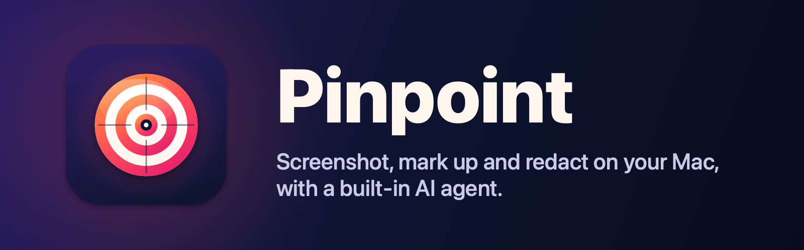

<p align="center"></p>

# Pinpoint

A native macOS screenshot and markup tool with a built-in AI agent. Capture, annotate, redact and hand off screenshots, and ask the agent to do the markup for you in plain English. Written in Swift: fast, small, no subscription.

## Features

- **Capture** an area, a window (including parts hidden behind other windows), one screen or all screens.
- **Mark up** with arrows, lines, shapes, text, callouts, highlights, numbered steps, voice-note pins, blur and black-box redaction.
- **Auto-redact** emails, API keys, phone and card numbers, IP addresses, SSNs, faces and your own words. This runs on your Mac, with no AI or internet needed.
- **AI agent**: type "point an arrow at the Save button" or "blur the faces", and it edits the image. Each run undoes in one step.
- **Library** of every capture, searchable by name, tag and the text inside the screenshot. Turn several captures into a step-by-step guide.
- **Handoff**: copy or export a capture with its notes, ready for a coding agent or a teammate.

## Install

### Download

Requires macOS 14 or later, on Apple silicon or Intel.

1. Download `Pinpoint-<version>.zip` from the [latest release](https://github.com/g-baskin/pinpoint/releases/latest) and double-click it to unzip.
2. Drag `Pinpoint.app` into your Applications folder and open it.
3. Pinpoint isn't notarized by Apple yet, so macOS blocks the first launch. Open **System Settings → Privacy & Security**, scroll down and click **Open Anyway** next to the Pinpoint message, then confirm. You only need to do this once.

Each release lists a SHA-256 checksum. To check your download, run `shasum -a 256 Pinpoint-<version>.zip` and compare.

### Build from source

Requires macOS 14 or later and Swift 5.10 or later (Xcode, or Apple's Command Line Tools: `xcode-select --install`).

```bash
git clone https://github.com/g-baskin/pinpoint.git
cd pinpoint
scripts/build-app.sh            # builds build/Pinpoint.app
open build/Pinpoint.app
scripts/build-app.sh --install  # optional: copies it to ~/Applications
```

On first launch, macOS asks for **Screen Recording** permission (System Settings → Privacy & Security → Screen & System Audio Recording). Turn on Pinpoint, then quit and reopen it.

If captures stop working after a rebuild, macOS has dropped that permission: toggle Pinpoint off and on again in the same pane. To stop it happening, run `scripts/setup-signing.sh` once. It creates a local signing certificate that every later build uses.

## Usage

Pinpoint opens one window: tools along the top, a **Properties** / **Assistant** sidebar on the right and recent captures along the bottom. The **Editor / Library** switch swaps the canvas for the full library. Close the window and Pinpoint stays in the menu bar.

| Shortcut | Action |
|---|---|
| ⌃⇧1 | Capture an area, or click a window (Return = whole screen, Esc = cancel) |
| ⌃⇧2 | Capture a window cleanly |
| ⌃⇧3 | Capture the screen under the mouse |
| ⌃⇧4 | Capture all screens |
| ⌃⇧L | Open the library |

**Tools** (press the letter): V select, A arrow, L line, R rectangle, E ellipse, T text, O callout, H highlight, N numbered step, M voice note, B blur, X black-box redact, C crop. Hold Shift for squares and 45° lines.

**Editing:** ⌘Z / ⇧⌘Z undo and redo, ⌘C copy, ⌘S save to the library, ⇧⌘E export as PNG, JPEG or HEIC.

**Assistant panel:** auto-redact, copy text (on-device OCR), summarize, name and tag, and a prompt box for the agent.

**Library:** captures are saved in `~/Pictures/Pinpoint/`. ⌘-click captures in order, then choose **Make Guide** to write `guide.md` and `guide.html` with images to `~/Pictures/Pinpoint/Guides/`.

## AI providers

Choose one in **Settings → AI provider**: ChatGPT (sign in with your plan, no API key), ChatGPT via the Codex CLI, Anthropic (Claude), OpenAI API, OpenRouter, Google Gemini, Ollama (local, no key) or any OpenAI-compatible server such as LM Studio.

Keys are stored in the macOS Keychain. Use **Fetch models** to pick a model and **Test connection** to check it. For agent edits, pick a model that supports both images and tool calling.

## Reporting a problem

Pinpoint doesn't send crash reports or usage data anywhere, so please tell us when something breaks: [open an issue](https://github.com/g-baskin/pinpoint/issues/new?template=bug_report.md) and include:

- **Logs.** Right after the problem, run this in Terminal and paste the output, after checking it for anything private:

  ```
  log show --last 15m --info --predicate 'subsystem == "app.pinpoint.Pinpoint"'
  ```

  To watch the log as it happens, run `log stream --info --predicate 'subsystem == "app.pinpoint.Pinpoint"'`, or open Console and search for `subsystem:app.pinpoint.Pinpoint`.
- **Crash report**, if Pinpoint quit unexpectedly: open Console, choose **Crash Reports** and attach the newest `Pinpoint` entry.

## Contributing

Contributions are welcome. Work happens on the `dev` branch, so open pull requests against `dev`.

- Run every check with `scripts/check.sh`, or just the tests with `swift test`. `scripts/release.sh` builds the universal download zip into `dist/`. App logic lives in `Sources/PinpointCore` (unit-tested), and the AppKit/SwiftUI app in `Sources/Pinpoint`.
- Project docs live in [`library/`](library/): the [glossary](library/knowledge/private/glossary/glossary.md), [decision records](library/knowledge/private/architecture/) and in-depth guides.
- **Adding an agent tool:** add a `ToolSpec` to `AgentToolbox.tools`, handle it in `execute`, and add a test in `Tests/PinpointCoreTests`.
- **Adding a markup kind:** add a case to `AnnotationKind`, draw it in `Renderer.draw`, and add a `Tool` case in `EditorModel.swift`.

## Releasing

For maintainers cutting a new version:

1. On `dev`, bump `CFBundleShortVersionString` (for example `0.1.0` to `0.2.0`) and increase `CFBundleVersion` (an integer) in `Resources/Info.plist`. `scripts/release.sh` reads the version from there for the zip name.
2. In `CHANGELOG.md`, move the `## [Unreleased]` entries under a new `## [x.y.z] - YYYY-MM-DD` heading, leaving an empty Unreleased section.
3. Run `scripts/check.sh`, commit, and push `dev`. Then fast-forward merge `dev` into `main` and push `main`.
4. On `main`, run `scripts/release.sh`. It builds a universal (Apple silicon and Intel) app, ad-hoc signs it, and writes `dist/Pinpoint-x.y.z.zip` and `dist/Pinpoint-x.y.z.zip.sha256`.
5. Tag and publish, using that version's CHANGELOG section as the notes:

   ```sh
   gh release create vx.y.z dist/Pinpoint-x.y.z.zip dist/Pinpoint-x.y.z.zip.sha256 \
     --target main --title "Pinpoint x.y.z" --notes "<the version's CHANGELOG section>"
   ```

Don't change the bundle id or switch `scripts/release.sh` to per-build signing: the fixed designated requirement is what keeps users' Screen Recording permission across updates. Downloads are not notarized yet.

## License

Copyright 2026 AutomationGod. Licensed under the [Apache License 2.0](LICENSE).

If you redistribute Pinpoint or build on it, keep the [`NOTICE`](NOTICE) file crediting the original author, and mark the files you changed. Anything you contribute is accepted under the same licence (Apache 2.0, section 5).

Pinpoint is built from scratch on public Apple frameworks and contains no third-party screenshot-app code or assets.
