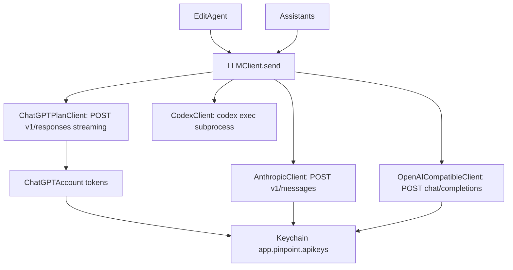
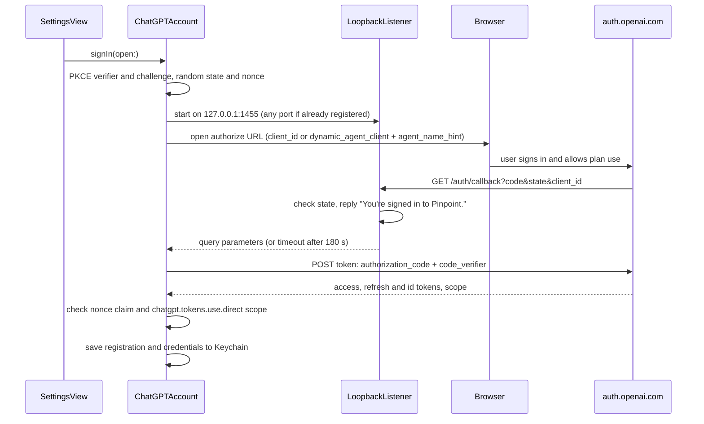

# Agent and Providers

> Category: AI | Version: 1.0 | Date: November 2026 | Status: Active

For contributors working on Pinpoint's AI features: the provider-neutral LLMClient protocol and its four client implementations, ChatGPT sign-in with its loopback callback, automatic model choice, the tool-using edit agent, the one-shot assistants, and how keys and tokens are stored.

**Related:**
- [`../analysis/analysis-and-redaction.md`](../analysis/analysis-and-redaction.md)
- [`../editor/markup-and-rendering.md`](../editor/markup-and-rendering.md)
- [`../storage/library-and-handoff.md`](../storage/library-and-handoff.md)
- [`../system/system-overview.md`](../system/system-overview.md)
- [`../glossary/glossary.md`](../glossary/glossary.md)
- [`../architecture/ADR-3-chatgpt-app-registration-name.md`](../architecture/ADR-3-chatgpt-app-registration-name.md)
- [`../architecture/ADR-2-stored-data-identifiers.md`](../architecture/ADR-2-stored-data-identifiers.md)

---

## Why a provider-neutral protocol

People reach AI models in very different ways: an API key for Anthropic or OpenAI, a local Ollama server, a ChatGPT subscription, or the Codex CLI they already signed into. Pinpoint hides these differences behind one protocol so the agent and assistants are written once (`Sources/PinpointCore/LLM.swift`):

```swift
public protocol LLMClient: Sendable {
    func send(system: String, messages: [ChatMessage], tools: [ToolSpec], maxTokens: Int) async throws -> ChatResponse
}
```

A `ChatMessage` has a role (user or assistant) and a list of `ChatPart`s: text, a PNG image, a tool use (id, name, JSON input) or a tool result (id, content, error flag). A `ToolSpec` is a name, description and JSON Schema. A `ChatResponse` returns parts plus a stop reason and exposes `text` and `toolCalls`. The `ask(system:prompt:images:maxTokens:)` extension sends one user message with no tools and returns plain text; the assistants use it.



---

## Providers and clients

`ProviderKind` lists the eight providers in the glossary, each with a display name, default base URL and starting model suggestion:

| Provider | Client | Default base URL | Needs key |
|---|---|---|---|
| `chatgpt` | `ChatGPTPlanClient` | `https://api.openai.com/v1` | No (sign-in) |
| `codex` | `CodexClient` | Empty: path to `codex`, auto-detected | No |
| `anthropic` | `AnthropicClient` | `https://api.anthropic.com` | Yes |
| `openai` | `OpenAICompatibleClient` | `https://api.openai.com/v1` | Yes |
| `openrouter` | `OpenAICompatibleClient` | `https://openrouter.ai/api/v1` | Yes |
| `gemini` | `OpenAICompatibleClient` | Gemini's OpenAI-compatible endpoint | Yes |
| `ollama` | `OpenAICompatibleClient` | `http://localhost:11434/v1` | No |
| `custom` | `OpenAICompatibleClient` | `http://localhost:1234/v1` | No |

`ProviderSettings.makeClient(apiKey:)` builds the right client and fails early with a readable message: not signed in to ChatGPT, Codex CLI not found, invalid base URL, no model chosen, or missing API key. `listModels` powers "Fetch models" in Settings: the ChatGPT plan's model list, Codex's fixed suggestions, Anthropic's `v1/models`, or the OpenAI-style `models` endpoint (stripping a `models/` prefix).

**AnthropicClient** posts to the Messages API with `x-api-key` and `anthropic-version: 2023-06-01`, a 180 second timeout, base64 PNG image blocks and native `tool_use` and `tool_result` blocks.

**OpenAICompatibleClient** posts to Chat Completions with an optional bearer key and a 300 second timeout. Images become `image_url` data URLs; tools become `function` tools. Tool results are emitted as separate `tool` role messages directly after the assistant turn, as that API requires. For OpenRouter hosts it adds attribution headers (`HTTP-Referer` and `X-Title: Pinpoint`).

Both share `perform`, which turns any non-2xx status into an `LLMError` carrying the server's error message where it can find one.

**CodexClient** (`Sources/PinpointCore/CodexClient.swift`) uses the ChatGPT subscription through OpenAI's Codex CLI. `locate` checks an explicit path or common install locations (Bun, Homebrew, `/usr/local/bin`, npm global, `~/.local/bin`, Volta, Cargo, and the newest nvm Node version), since Finder-launched apps get a minimal `PATH`. Each `send` creates a temporary folder, writes attached images there and runs `codex exec --skip-git-repo-check --ephemeral -s read-only` with low reasoning effort, the prompt on stdin and the final message written to a file. Codex has no tool-calling API here, so when tools are offered the client passes a JSON output schema (`{"reply", "tool_calls": [{"name", "arguments_json"}]}`) and converts the result back into tool-use parts. The whole conversation is flattened into one prompt because each run is stateless. Runs time out after 240 seconds; failures whose stderr mentions login or auth produce a "run `codex login`" message.

---

## ChatGPT sign-in

"Sign in with ChatGPT" lets people use their ChatGPT plan through the OpenAI API without an API key (`Sources/PinpointCore/ChatGPTPlan.swift`). It is OAuth with PKCE and dynamic app registration under the agent name `Pinpoint` ([ADR-3](../architecture/ADR-3-chatgpt-app-registration-name.md)), with the redirect caught by a tiny HTTP server on the loopback address.



Details that matter when changing this flow:

- **Registration.** On first sign-in the authorize request uses the client id `dynamic_agent_client` and hints the agent name; the issued `client_id` comes back on the callback and is stored as a `Registration` in the Keychain. Later sign-ins reuse it. Sign-in fails if no real client id was issued. If the registration or credentials can't be written to the Keychain, sign-in clears the credentials and throws "Signed in, but Pinpoint couldn't save the sign-in to your Keychain".
- **Host id.** A stable `urn:uuid:` host id is kept in UserDefaults under `chatgptHostId` and sent as `ext_agent_host_id`.
- **Loopback listener.** `LoopbackListener` binds `127.0.0.1` with Network.framework, answers only `/auth/callback`, rejects a mismatched `state` with 400, and finishes once. First-time sign-in requires port 1455; if it is busy the error says another sign-in may be open. Cancelling the task or 180 seconds without a callback ends the wait.
- **Checks.** A denied request gives a specific message. The id token's `nonce` claim must match (the JWT payload is decoded without a signature check, as the code notes it came straight from the issuer over TLS), and the granted scopes must include `chatgpt.tokens.use.direct`.
- **Refresh.** `accessToken()` returns the stored token unless it expires within 60 seconds; otherwise one shared refresh task posts a `refresh_token` grant, so concurrent callers do not refresh twice. A failed refresh asks the user to sign in again. If the refreshed token can't be saved to the Keychain, the failure is logged and the token is still used for this session.
- **Sign-out** revokes the refresh token (best effort) and clears the stored credentials.

**ChatGPTPlanClient** posts to `v1/responses` with the bearer token and `stream: true`, `store: false`, and the agent's tools wrapped in a `pinpoint` namespace. It reads server-sent events and folds text deltas, completed function calls and final output into a `ChatResponse` (`collect(events:)`), stripping the namespace prefix from tool names. A 404 for an unknown model and a 429 plan limit get friendlier messages.

### ModelPicker

With the ChatGPT provider the default model is `auto`. `ModelPicker` scores model ids: it rejects audio, realtime, embedding, image, search, moderation and similar ids, scores `gpt-N.M` families by version, places o-series reasoning models lower as slower, and penalises `pro`, `nano`, `codex` and preview or dated variants. `mini` is penalised normally but boosted in fast mode. `auto-fast` is used for background naming (`AppSettings.makeClient(fast: true)`). The plan's model list is cached in UserDefaults for a day. If the chosen model is refused (HTTP 404, or HTTP 400 mentioning the model), the client refreshes the list and tries the next best, up to three attempts.

---

## The edit agent

The agent edits a capture from a plain-English prompt by calling tools (`Sources/PinpointCore/Agent.swift`). It never touches the editor directly: it works on a copy of the editable state, `AgentState` (markup items, crop, name, tags, image size), and the editor applies the result as one undoable step.

```mermaid
sequenceDiagram
    participant Ed as EditorModel.runAgent
    participant Ag as EditAgent
    participant LLM as LLMClient
    participant Box as AgentToolbox

    Ed->>Ed: ensure Analysis (run Analyzer if needed)
    Ed->>Ag: run(instruction, image, analysis, state, color)
    Ag->>Ag: downscale image to 1568 px max, build OCR and sensitive summary
    loop up to 12 steps
        Ag->>LLM: send(system, messages, AgentToolbox.tools)
        LLM-->>Ag: text and tool calls
        alt no tool calls
            Ag-->>Ed: (state, reply)
        else tool calls
            Ag->>Box: execute each call
            Box-->>Ag: result text, error flag
            Ag->>LLM: tool results as next user message
        end
    end
    Ed->>Ed: checkpoint and apply markup and crop if changed, update name and tags
```

The first message contains the downscaled screenshot plus context: up to 250 OCR lines with their boxes, counts of sensitive items found on-device, the current markup list, the capture name and the request. The system prompt tells the model to edit only through tools, prefer `mark_text` for visible text, use `redact_sensitive` first for privacy requests, and finish with a short reply and no tool calls. After 12 steps the loop stops with "Stopped after 12 steps." Cancellation is checked each step; the Assistant panel's stop button cancels the task.

### Coordinates

The model sees a downscaled image, so `AgentToolbox` keeps a `scale` (model pixels = original pixels times scale). Every coordinate coming in is divided by the scale and clamped to the image; every coordinate going out (OCR boxes, markup positions) is multiplied by it.

### AgentToolbox tools

`AgentToolbox` is pure (no network) and unit-tested directly. Its seven tools:

| Tool | Effect |
|---|---|
| `add_annotation` | Adds one markup item of any kind from `x1, y1` and, for arrows, lines and boxes, `x2, y2`. Text and callouts need text; a note needs text, which is stored as the note. Steps number themselves. Colour by name or hex; redact defaults to black |
| `mark_text` | Finds OCR text with `Analyzer.find` and marks every match (or the first) with an arrow (optional label near the tail), step badge, rectangle, ellipse, highlight (yellow by default), blur or redact. If nothing matches it returns an error listing visible text and suggests coordinates instead |
| `redact_sensitive` | Applies `Analyzer.redactions` to on-device detections, optionally limited to kinds |
| `list_annotations` | Lists markup with short ids and positions |
| `remove_annotations` | Removes by short or full id, or everything with `all` |
| `crop` | Sets a crop of at least 4 by 4 pixels inside the image, or resets it |
| `set_name_and_tags` | Renames (max 80 characters) and sets lowercase tags |

New items use the image-scaled default line width and font size and the editor's current colour.

---

## Assistants

`Assistants` (`Sources/PinpointCore/Assistants.swift`) are one-shot calls on any `LLMClient`:

| Function | Input | Output | Used by |
|---|---|---|---|
| `summarize` | Image (1280 px max) and up to 6000 OCR characters | 2 to 4 sentences plus bullets | Assistant panel "Summarize"; saved to `CaptureMeta.summary` |
| `nameAndTags` | Image (1024 px max), app name, up to 2000 OCR characters | JSON name (max 80 characters) and up to 8 lowercase tags; the prompt forbids secrets and personal data | Background naming after capture, Assistant panel "Name & tag", Library "Auto-name" |
| `writeGuide` | Ordered `GuideStep`s (image 1024 px max, name, OCR) | Markdown with `{{image N}}` placeholders | Library "Make Guide"; see [`../storage/library-and-handoff.md`](../storage/library-and-handoff.md) |

The Assistant panel also has Auto-redact and Copy text, which are on-device and need no provider ([`../analysis/analysis-and-redaction.md`](../analysis/analysis-and-redaction.md)).

---

## Key and token storage

`Keychain` stores generic passwords under the service `app.pinpoint.apikeys`. API keys use the provider's raw value as the account (`AppSettings.apiKey(_:)` and `setAPIKey`); ChatGPT credentials and registration are JSON strings under `chatgpt.credentials` and `chatgpt.registration`. Setting an empty value deletes the item. Writes report success: `setAPIKey` returns a Bool so Settings can show "Couldn't save the key to Keychain", and `ChatGPTAccount`'s `save(_:)`/`saveRegistration(_:)` return the write's result. The service name is a fixed identifier: changing it orphans saved keys and sign-ins ([ADR-2](../architecture/ADR-2-stored-data-identifiers.md)).

Provider choice, per-provider model and base URL live in UserDefaults; see [`../storage/library-and-handoff.md`](../storage/library-and-handoff.md).
