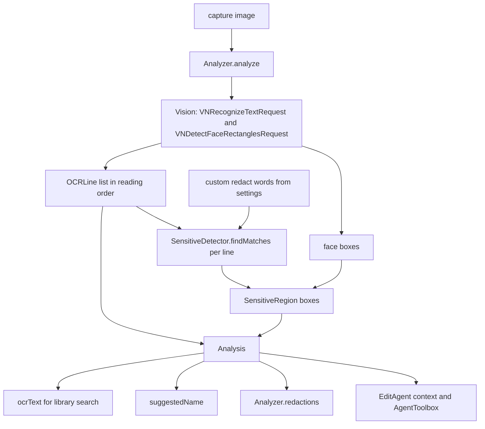
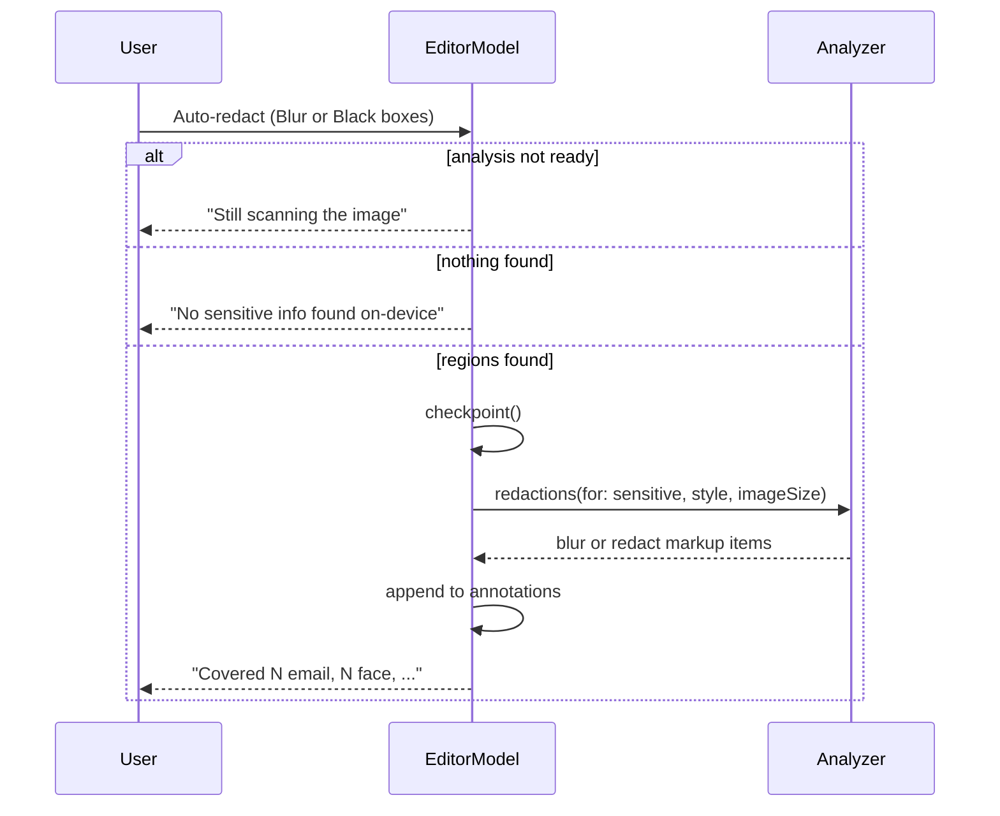

# Analysis and Redaction

> Category: Analysis | Version: 1.0 | Date: November 2026 | Status: Active

For contributors working on on-device intelligence: how Pinpoint reads text and finds faces with Apple Vision, how SensitiveDetector spots secrets and personal data in that text, how auto-redact turns detections into markup items, and how UIRegionDetector finds panels for smart selection.

**Related:**
- [`../capture/capture-pipeline.md`](../capture/capture-pipeline.md)
- [`../editor/markup-and-rendering.md`](../editor/markup-and-rendering.md)
- [`../ai/agent-and-providers.md`](../ai/agent-and-providers.md)
- [`../storage/library-and-handoff.md`](../storage/library-and-handoff.md)
- [`../glossary/glossary.md`](../glossary/glossary.md)

---

## Why analysis stays on the device

Screenshots often contain things that must not leave the machine: emails, API keys, card numbers, faces. Pinpoint's analysis therefore runs entirely locally with Apple Vision and regular expressions, with no network calls (`Sources/PinpointCore/Analyzer.swift`). The results feed four consumers: library search (OCR text in `meta.json`), offline capture names, auto-redact, and the AI agent, which receives the OCR boxes so it can target text precisely. Everything here lives in `PinpointCore` and is unit-testable.

---

## Analyzer

`Analyzer.analyze(_:faces:customTerms:)` runs one `VNImageRequestHandler` with an accurate text recognition request (language correction off, which suits codes and identifiers) and, when `faces` is true, a face rectangle request.

Vision returns normalised boxes with a bottom-left origin. `analyze` converts every box to **image pixels with a top-left origin**, the same space as markup items, so detections can become markup without further conversion.

Text observations are sorted into reading order, top to bottom and then left to right (lines whose tops differ by less than 1% of the height count as one row). Each top candidate becomes an `OCRLine(text, rect)`. Each line is then scanned by `SensitiveDetector`; for every match, Vision's `boundingBox(for:)` gives the box of just the matched characters, falling back to the whole line's box. Faces become `SensitiveRegion`s of kind `face`, with the box grown by 15% of its width and 20% of its height on each side.

The result is an `Analysis` with `lines`, `sensitive` and a computed `fullText` (lines joined by newlines).

### Who calls it and when

| Caller | Faces | Purpose |
|---|---|---|
| `AppDelegate.postProcess` (`Sources/Pinpoint/AppDelegate.swift`) | No | Background OCR after every capture, sets `ocrText` and the offline name |
| `EditorModel.startAnalysis` (`Sources/Pinpoint/EditorModel.swift`) | Yes | Runs at user-initiated priority whenever a capture opens, with the user's custom redact words; fills `ocrText` if it was empty |
| `EditorModel.runAgent` | Yes | Runs inline if the editor's analysis has not finished yet |

### Helpers

`Analyzer.find(_:in:)` returns OCR lines containing the query case-insensitively, and falls back to lines sharing any word with it. The agent's `mark_text` tool uses it.

`Analyzer.suggestedName(from:app:)` picks the first OCR line with at least four letters, at most 80 characters and no sensitive match, truncated to 60 characters. Without one it returns `<app> capture` or `Capture`. This keeps secrets out of offline names.

---

## SensitiveDetector

`SensitiveDetector` (`Sources/PinpointCore/Sensitive.swift`) finds secrets and personal data in plain text. It is pure and fast and runs on OCR output, one line at a time.

`SensitiveKind` has nine cases, each with a user-facing label: `email`, `apiKey` ("API key / secret"), `accountID` ("Account / ad ID"), `phone`, `creditCard` ("Card number"), `ipAddress`, `ssn`, `custom` ("Your redact word") and `face`.

### Matching order

`findMatches(in:customTerms:)` works in a fixed order, and the order matters because a later match that overlaps an earlier one is skipped.

1. **Custom words first.** Each user term of at least two characters is found everywhere in the text, ignoring case and diacritics, as kind `custom`.
2. **Patterns in list order.** The regular expressions are tried in this order:

| Kind | What the patterns cover |
|---|---|
| email | Standard address shape, case-insensitive |
| apiKey | AWS access key ids (`AKIA`, `ASIA`), GitHub tokens (`ghp_` style), Slack tokens (`xox?-`), Google API keys (`AIza`), `sk`/`pk`/`rk` prefixed keys with optional `live`, `test`, `proj` or `ant` segment, JWT-shaped tokens (`eyJ...`), `api key`/`secret`/`token`/`password` followed by `:` or `=` and a value, Meta access tokens (`EAA`), Google OAuth access tokens (`ya29.`), Shopify tokens (`shpat_` style) |
| accountID | Meta ad accounts (`act_`), Stripe object ids (`acct_`, `cus_`, `sub_` and similar), GA4 (`G-`), Universal Analytics (`UA-`), Google Tag Manager (`GTM-`), Google Ads conversion ids (`AW-`), Google Ads customer ids written as `123-456-7890` after "customer", "account" or "ad" |
| creditCard | 13 to 19 digits with optional spaces or dashes, kept only if the Luhn check passes |
| ssn | `123-45-6789` shape |
| phone | Optional country code, then a 3-3-4 digit pattern with separators |
| ipAddress | Dotted IPv4 with each octet 0 to 255 |
| accountID | Any remaining 15 to 19 digit number (long numeric ids); real card numbers were already caught above |

Because overlapping matches are dropped, specific patterns win over generic ones: a Luhn-valid card number is labelled a card, and only leftover long numbers become account ids. The Luhn check (`luhnValid`) also requires 13 to 19 digits.

Test fixtures that look like real secrets must be built by string concatenation because GitHub push protection rejects secret-shaped literals (see `SensitiveTests` in `Tests/PinpointCoreTests/CoreTests.swift`).

---

## Auto-redact

Auto-redact turns detections into ordinary blur or redact markup items, so the user can still move, resize, delete or undo them.

`Analyzer.redactions(for:style:kinds:imageSize:)` optionally filters regions by kind, pads each box by the larger of 3 pixels or 15% of its height, clips it to the image and returns an `Annotation` of kind `.redact` when the style is redact, otherwise `.blur`, with black colour and zero line width.

There are three entry points:

- **Assistant panel.** The Auto-redact menu (`Sources/Pinpoint/EditorView.swift`) offers Blur or Black boxes and calls `EditorModel.autoRedact(style:)`, which adds one undoable step and reports counts per kind.
- **On capture.** With the "auto-redact on capture" setting on (default off), `AppDelegate` waits for the new editor's analysis and calls `autoRedact(style: .blur)`; see [`../capture/capture-pipeline.md`](../capture/capture-pipeline.md).
- **The agent.** The `redact_sensitive` tool applies the same function, optionally limited to chosen kinds; see [`../ai/agent-and-providers.md`](../ai/agent-and-providers.md).

The custom words come from the comma or newline separated `customRedactTerms` setting (`AppSettings.redactTerms`, terms shorter than two characters dropped). Blur items render as pixelation and redact items as solid boxes; see [`../editor/markup-and-rendering.md`](../editor/markup-and-rendering.md).

---

## UIRegionDetector

`UIRegionDetector` (`Sources/PinpointCore/UIRegionDetector.swift`) finds UI structure (toolbars, sidebars, panels, dialogs) inside a window's pixels, without Accessibility permission. `SelectionOverlay` uses it for smart selection (see [`../capture/capture-pipeline.md`](../capture/capture-pipeline.md)).

It uses a recursive XY-cut on a greyscale copy, downscaled so the longer side is at most 1100 pixels:

1. **Find cuts.** A row (or column) is a cut when at least 88% of the pixels across the span differ from the previous row by a luminance step of 14 or more. Cuts within 4 pixels of each other collapse to one, because a thin separator line produces two edges.
2. **Split.** The region is divided at the cuts, skipping the separator line and any strip thinner than 24 working pixels. Each piece is split again with the other axis tried first, up to depth 5. If only one piece survives, its children are adopted directly so no duplicate level appears.
3. **Fallback to boxes.** When no full-span cuts exist, `componentBoxes` looks for self-contained blobs (dialogs, cards, text blocks) on a plain background: it finds the dominant grey level, marks 4-pixel cells that differ from it, dilates by one cell, flood-fills connected cells and keeps boxes at least 24 pixels on each side and smaller than 85% of the region, up to the 40 largest.

The result is a tree of `Node`s in source-image pixels. `Node.path(to:)` returns the regions containing a point from the root down to the smallest, which is exactly the list the overlay steps through with the scroll wheel.
