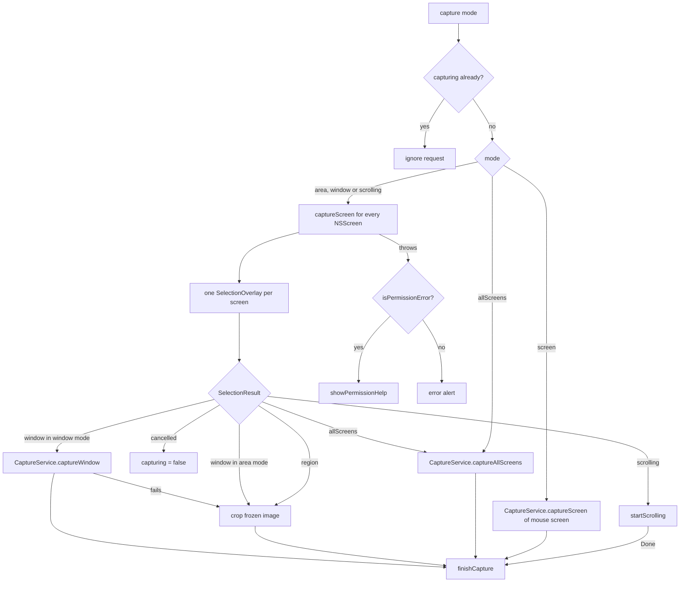
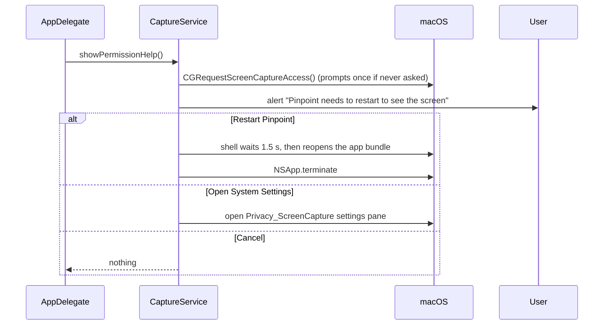
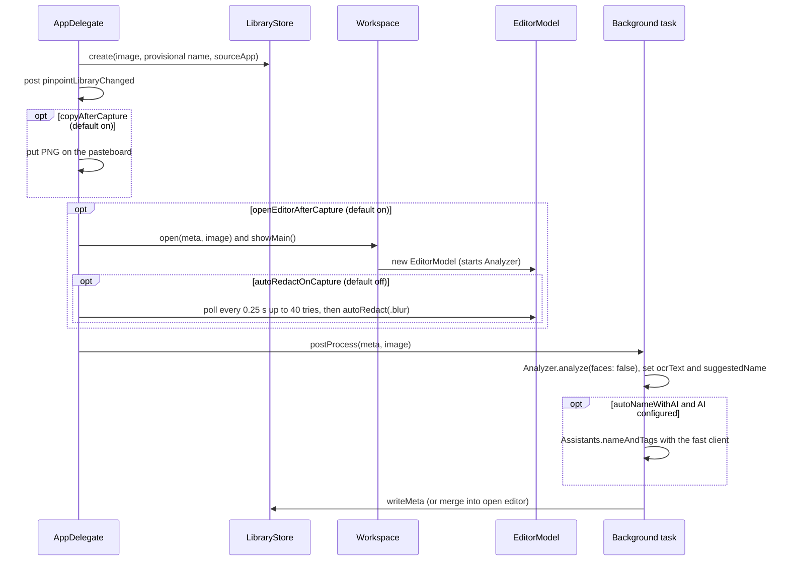

# Capture Pipeline

> Category: Capture | Version: 1.0 | Date: November 2026 | Status: Active

For contributors working on taking screenshots: how a capture request becomes an image through ScreenCaptureKit and the selection overlay, how scrolling capture stitches a long image, how Screen Recording permission failures are handled, and what happens to the image afterwards.

**Related:**
- [`../system/system-overview.md`](../system/system-overview.md)
- [`../analysis/analysis-and-redaction.md`](../analysis/analysis-and-redaction.md)
- [`../editor/markup-and-rendering.md`](../editor/markup-and-rendering.md)
- [`../storage/library-and-handoff.md`](../storage/library-and-handoff.md)
- [`../glossary/glossary.md`](../glossary/glossary.md)
- [`../architecture/ADR-2-stored-data-identifiers.md`](../architecture/ADR-2-stored-data-identifiers.md)

---

## Why the screen is frozen first

The interactive capture modes do not stream the live screen while you choose. Instead, `AppDelegate.capture(_:)` (`Sources/Pinpoint/AppDelegate.swift`) takes a still image of every display first and shows the picker on top of those frozen images. What you select is exactly what was on screen when you pressed the shortcut, menus and hover states included, and the region you choose is cut straight out of an image that already exists.

## Capture modes

`CaptureMode` (defined in `AppDelegate.swift`) has five cases:

| Mode | Shortcut | What happens |
|---|---|---|
| `area` | Control+Shift+1 | Freeze all displays, show the overlay; drag a region, click a panel or window, or target a whole screen |
| `window` | Control+Shift+2 | Same overlay with `preferWindow: true`: hovering highlights whole windows, and the result is grabbed from the window itself |
| `screen` | Control+Shift+3 | Capture the display under the mouse directly, no overlay |
| `allScreens` | Control+Shift+4 | Capture every display and stitch them into one image, no overlay |
| `scrolling` | Control+Shift+5 | Same overlay in scrolling mode; the pick becomes a live area that is followed while you scroll (see [Scrolling capture](#scrolling-capture)) |

Before starting, `capture(_:)` records the screen under the mouse, the frontmost app's name (used as the capture's source app) and the list of visible windows.

---

## CaptureService

`CaptureService` (`Sources/Pinpoint/CaptureService.swift`) is a main-actor enum wrapping ScreenCaptureKit.

- **`captureScreen(_:)`** asks `SCShareableContent` for on-screen content, finds the `SCDisplay` whose id matches the `NSScreen`, and builds an `SCContentFilter` for that display that excludes Pinpoint's own application, so its windows never appear in the shot. The stream configuration uses the display size times the screen's backing scale factor, hides the cursor and requests the best capture resolution. `SCScreenshotManager.captureImage` returns the `CGImage`.
- **`captureAllScreens()`** returns a single-screen capture directly when there is one display. Otherwise it captures each screen, places each at its global top-left origin (`cgOrigin`), computes the union rectangle, and draws every shot into one sRGB bitmap at the highest backing scale among the screens, using `Renderer.drawImage` so images are not flipped.
- **`captureWindow(_:scale:)`** finds the `SCWindow` by id and captures it with a desktop-independent window filter, shadows off and cursor hidden. This captures the window's own content, including parts covered by other windows.
- **`visibleWindows()`** reads `CGWindowListCopyWindowInfo` for on-screen windows and keeps only layer 0 windows not owned by Pinpoint, with alpha above 0.01 and both sides larger than 40 points. Each becomes a `WindowInfo` (id, owner name, title, frame in global top-left coordinates). The list is front to back.

## SelectionOverlay

`SelectionOverlay` (`Sources/Pinpoint/SelectionOverlay.swift`) is a borderless window at `.screenSaver` level that covers one screen and joins all Spaces. `AppDelegate` creates one per display, presents all of them, and makes the one under the mouse key so it receives Escape and Return. When any overlay finishes, the delegate dismisses all overlays (a dismissed overlay drops its completion so it never reports) and handles the result.

The overlay's view draws the frozen image, dims everything except the candidate selection and labels it with its pixel size. Without an active drag it also shows an instruction label and a bottom toolbar with Full Screen (F), All Screens (A), Scrolling (S) and Cancel (Esc or right-click) buttons.

### How input maps to a result

`SelectionResult` has five cases: `region` (a rect in frozen-image pixels), `window` (a `WindowInfo` plus its visible rect), `allScreens`, `scrolling` (a rect in frozen-image pixels) and `cancelled`. In scrolling mode every pick that would give `region` or `window` gives `scrolling` instead.

| Input | Result |
|---|---|
| Drag at least 4 by 4 points | `region` of the dragged rect |
| Click on a window | `window` with the window's visible rect |
| Click on a smaller panel inside a window | `region` of that panel |
| Click within 10 points of a screen edge, on bare desktop, Return, Enter, F or the Full Screen button | `region` covering this whole screen |
| A or the All Screens button | `allScreens` |
| Escape, right-click, other-button click or Cancel | `cancelled` |
| Scroll wheel, Up and Down arrows | Step between bigger and smaller nested regions |
| S or the Scrolling button | Toggle scrolling mode for the next pick (the button stays highlighted while it is on) |

### Smart selection inside windows

In area mode, hovering a window does not only offer the whole window. The view calls `UIRegionDetector.detect` on the window's area of the frozen image (cached per window id) and asks the resulting tree for the path of nested regions under the mouse. The highlight starts on the smallest part (a panel, toolbar or dialog), and scrolling up or pressing Up steps out towards the whole window. Parts smaller than 12 points are ignored. In window mode (`preferWindow`) this is skipped and only whole windows are offered. How the detector finds panels is covered in [`../analysis/analysis-and-redaction.md`](../analysis/analysis-and-redaction.md).

### Defensive drawing

Window titles go through `safeLabel`, which strips emoji, control, private-use and joiner characters and truncates to 140 characters; the code notes some titles crashed CoreText. Every rectangle drawn passes `isUsable`, which rejects null, infinite, empty and non-finite rects that would crash `NSBezierPath`.

---

## Scrolling capture

Scrolling capture makes one tall image of something longer than the screen, such as a web page, a chat or a sidebar. Pinpoint does not scroll for you: you scroll by hand while it watches one rectangle of the live screen and joins what it sees. That is why it needs no Accessibility permission, only the Screen Recording permission every capture needs.

### Starting and stopping

Control+Shift+5, the Scrolling Capture menu item (status menu and File menu) or pressing S or the Scrolling (S) button in the selection overlay switches the next pick to scrolling mode. The pick works as usual (drag an area, click a smart-selected panel such as a sidebar, click a window, or take the full screen) and yields `SelectionResult.scrolling` with a pixel rect. `handleSelection` converts it to points and calls `startScrolling`, which creates a `ScrollCaptureSession` (`Sources/Pinpoint/ScrollCaptureSession.swift`) and keeps it in `scrollSession`.

`session.start()` does the following, in order:

1. Takes the first frame with `SCScreenshotManager`, using a display filter that excludes Pinpoint's own windows and a `sourceRect` set to the picked area at the screen's backing scale. A permission or other error surfaces here and gets the same help or alert as a still capture.
2. Shows a click-through dashed outline around the area (it ignores the mouse, so scrolling reaches the page) and a non-activating panel with the current height, a hint and Done and Cancel buttons. Both windows are left out of the frames by the filter.
3. Re-activates the app that was frontmost before the capture, so the trackpad, wheel and keyboard keep acting on the page.
4. Loops: grab the same rectangle, hand the frame to `ScrollStitcher.add` in a detached task, update the panel, sleep about 80 ms. A failed grab shows "Capture paused" and the loop tries again.

Done, or Control+Shift+5 again, calls `finish()`: the loop stops, the stitched image is built and passed to `finishCapture`, so it is saved, copied and opened like any other capture. Cancel discards it. While a session runs, other capture shortcuts are ignored.

### How frames are stitched

`ScrollStitcher` (`Sources/PinpointCore/ScrollStitcher.swift`) is pure image code in PinpointCore, so it is unit-tested without the screen (`Tests/PinpointCoreTests/ScrollStitcherTests.swift`). For each new frame it compares against the last good one:

1. **Changed columns.** It finds the leftmost and rightmost columns whose pixels changed, ignoring a margin on the right (20 points, scaled) where a scrollbar moves. Matching only that band keeps static content beside the scrolling part from hiding the shift.
2. **Row hashes.** Each row within that band gets a hash of its brightness values. A row counts as informative when its brightness range is wide enough; flat background rows match anything and are not counted.
3. **Sticky bands.** Rows that are identical at the top and bottom of both frames are a sticky header and footer. They are excluded from matching.
4. **Best shift.** It tries every vertical shift that leaves enough overlap and scores the share of informative rows that line up. The best score must be at least 0.8; ties go to the smaller shift.
5. **Commit.** New rows below what is already kept are appended to an RGBA canvas. Scrolling back up over known content adds nothing, and scrolling down again resumes where the canvas ends.

`add` reports a `Step`: `started`, `unchanged`, `added(rows)`, `lostTrack` (no good overlap, usually from scrolling too far between frames; the panel asks you to scroll back a little and go slower) or `full` (the 50 million pixel cap was reached; later frames are ignored). `makeImage()` returns the canvas with the last frame's sticky footer appended, so a page footer or input bar appears once, at the bottom.

### Limits

- Vertical scrolling only, downwards from where it starts: rows scrolled back above the first frame are not added, so start at the top.
- The right-edge scrollbar margin (20 points) shrinks to a quarter of the width for narrow regions, so thin panels still match.
- If Screen Recording permission is lost mid-session, the session cancels and shows the permission help.
- No keyboard cancel: the control panel never takes focus. Use Cancel, or ⌃⇧5 / Done to finish.
- Content must move by whole pixels; the match compares exact row hashes, so a shift that blends rows finds no overlap.
- Anything static beside the scrolling part but inside the selection (a fixed sidebar next to a scrolling page, for example) is repeated down the image. Select just the part that scrolls; clicking a smart-selected panel is the easiest way.

---

## Screen Recording permission

macOS requires Screen Recording permission for ScreenCaptureKit. Pinpoint deliberately does not prompt at launch. When a capture throws, `AppDelegate` logs the error with the preflight result and calls `CaptureService.isPermissionError`, which treats an error as a permission problem when it is a `CaptureError`, has code -3801 (the user declined) or when `CGPreflightScreenCaptureAccess()` reports no access.

For permission errors `showPermissionHelp()` runs:

The alert explains that macOS only applies a new grant after the app restarts, so the first button is "Restart Pinpoint". `relaunch()` starts a shell that waits 1.5 seconds and reopens the bundle, then terminates the app, avoiding a race with the quitting process. If that helper can't be launched, it shows a "Couldn't restart Pinpoint" alert asking the user to quit and reopen, and does not quit. The request call never resets an existing grant. Permission is tied to the bundle id and the signing requirement in `scripts/build-app.sh` (see [ADR-2](../architecture/ADR-2-stored-data-identifiers.md)).

Other errors show a standard `NSAlert`.

---

## After a capture

Every successful path ends in `finishCapture(_:app:)`. Opening an image file from disk (`openImage`) follows nearly the same steps, without the clipboard and auto-redact settings. Files that aren't readable images or can't be added to the library are collected and reported together in one error alert after the others open.

1. **Save.** `LibraryStore.create` writes the original, a thumbnail and `meta.json` immediately, with a provisional name of the source app (or "Screen") plus the date and time.
2. **Copy.** If "copy after capture" is on, the PNG goes on the general pasteboard.
3. **Edit.** If "open editor after capture" is on, the capture opens in the main window. Creating the `EditorModel` starts on-device analysis. If auto-redact on capture is on, the delegate waits for that analysis (polling every 0.25 seconds, giving up after 40 tries) and then adds blur markup items.
4. **Background naming.** `postProcess` runs a detached utility-priority task: OCR without face detection, an offline name from the first meaningful text line, and optionally an AI name and tags. When it finishes on the main actor it does not clobber edits: if the capture is open, it only replaces the name if the user has not changed it and only sets tags if there are none, then writes the editor's meta (otherwise its own result) with a single `writeMeta`. A client, AI naming or write failure is logged with `NSLog` instead of being dropped silently; OCR failure still yields an empty analysis.

Settings and their defaults live in `Sources/Pinpoint/AppSettings.swift`; see [`../storage/library-and-handoff.md`](../storage/library-and-handoff.md). Editing the capture is covered in [`../editor/markup-and-rendering.md`](../editor/markup-and-rendering.md).
