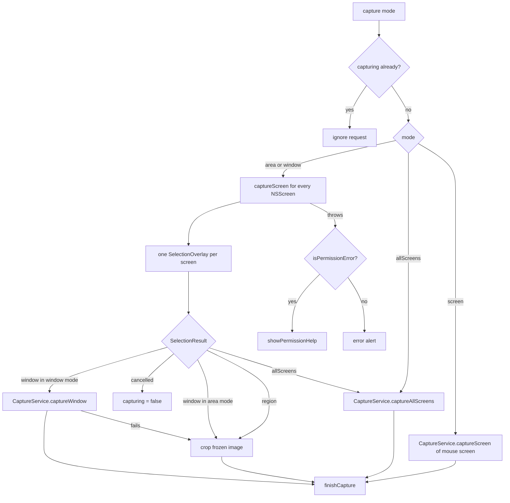
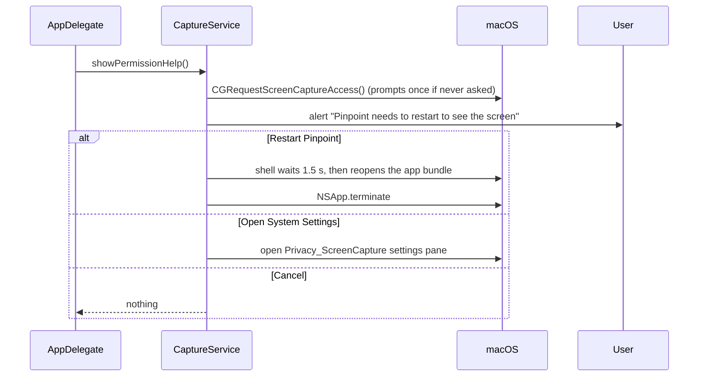
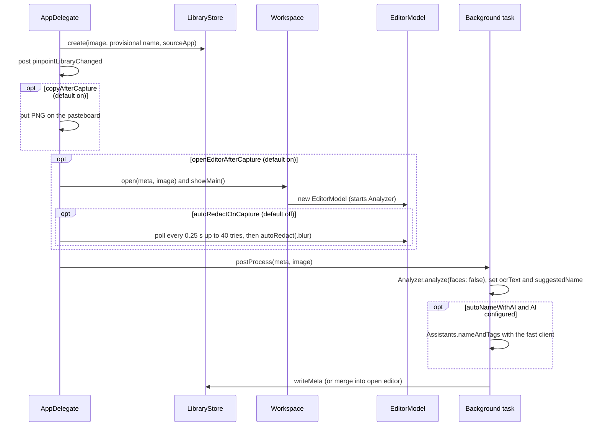

# Capture Pipeline

> Category: Capture | Version: 1.0 | Date: November 2026 | Status: Active

For contributors working on taking screenshots: how a capture request becomes an image through ScreenCaptureKit and the selection overlay, how Screen Recording permission failures are handled, and what happens to the image afterwards.

**Related:**
- [`../system/system-overview.md`](../system/system-overview.md)
- [`../analysis/analysis-and-redaction.md`](../analysis/analysis-and-redaction.md)
- [`../editor/markup-and-rendering.md`](../editor/markup-and-rendering.md)
- [`../storage/library-and-handoff.md`](../storage/library-and-handoff.md)
- [`../glossary/glossary.md`](../glossary/glossary.md)
- [`../architecture/ADR-2-stored-data-identifiers.md`](../architecture/ADR-2-stored-data-identifiers.md)

---

## Why the screen is frozen first

The interactive capture modes do not stream the live screen while you choose. Instead, `AppDelegate.capture(_:)` (`Sources/Pinpoint/AppDelegate.swift`) takes a still image of every display first and shows the picker on top of those frozen images. What you select is exactly what was on screen when you pressed the shortcut, menus and hover states included, and the region you choose is cut straight out of an image that already exists.

## Capture modes

`CaptureMode` (defined in `AppDelegate.swift`) has four cases, matching the glossary's capture modes:

| Mode | Shortcut | What happens |
|---|---|---|
| `area` | Control+Shift+1 | Freeze all displays, show the overlay; drag a region, click a panel or window, or target a whole screen |
| `window` | Control+Shift+2 | Same overlay with `preferWindow: true`: hovering highlights whole windows, and the result is grabbed from the window itself |
| `screen` | Control+Shift+3 | Capture the display under the mouse directly, no overlay |
| `allScreens` | Control+Shift+4 | Capture every display and stitch them into one image, no overlay |

Before starting, `capture(_:)` records the screen under the mouse, the frontmost app's name (used as the capture's source app) and the list of visible windows.

---

## CaptureService

`CaptureService` (`Sources/Pinpoint/CaptureService.swift`) is a main-actor enum wrapping ScreenCaptureKit.

- **`captureScreen(_:)`** asks `SCShareableContent` for on-screen content, finds the `SCDisplay` whose id matches the `NSScreen`, and builds an `SCContentFilter` for that display that excludes Pinpoint's own application, so its windows never appear in the shot. The stream configuration uses the display size times the screen's backing scale factor, hides the cursor and requests the best capture resolution. `SCScreenshotManager.captureImage` returns the `CGImage`.
- **`captureAllScreens()`** returns a single-screen capture directly when there is one display. Otherwise it captures each screen, places each at its global top-left origin (`cgOrigin`), computes the union rectangle, and draws every shot into one sRGB bitmap at the highest backing scale among the screens, using `Renderer.drawImage` so images are not flipped.
- **`captureWindow(_:scale:)`** finds the `SCWindow` by id and captures it with a desktop-independent window filter, shadows off and cursor hidden. This captures the window's own content, including parts covered by other windows.
- **`visibleWindows()`** reads `CGWindowListCopyWindowInfo` for on-screen windows and keeps only layer 0 windows not owned by Pinpoint, with alpha above 0.01 and both sides larger than 40 points. Each becomes a `WindowInfo` (id, owner name, title, frame in global top-left coordinates). The list is front to back.

## SelectionOverlay

`SelectionOverlay` (`Sources/Pinpoint/SelectionOverlay.swift`) is a borderless window at `.screenSaver` level that covers one screen and joins all Spaces. `AppDelegate` creates one per display, presents all of them, and makes the one under the mouse key so it receives Escape and Return. When any overlay finishes, the delegate dismisses all overlays (a dismissed overlay drops its completion so it never reports) and handles the result.

The overlay's view draws the frozen image, dims everything except the candidate selection and labels it with its pixel size. Without an active drag it also shows an instruction label and a bottom toolbar with Full Screen (F), All Screens (A) and Cancel (Esc or right-click) buttons.

### How input maps to a result

`SelectionResult` has four cases: `region` (a rect in frozen-image pixels), `window` (a `WindowInfo` plus its visible rect), `allScreens` and `cancelled`.

| Input | Result |
|---|---|
| Drag at least 4 by 4 points | `region` of the dragged rect |
| Click on a window | `window` with the window's visible rect |
| Click on a smaller panel inside a window | `region` of that panel |
| Click within 10 points of a screen edge, on bare desktop, Return, Enter, F or the Full Screen button | `region` covering this whole screen |
| A or the All Screens button | `allScreens` |
| Escape, right-click, other-button click or Cancel | `cancelled` |
| Scroll wheel, Up and Down arrows | Step between bigger and smaller nested regions |

### Smart selection inside windows

In area mode, hovering a window does not only offer the whole window. The view calls `UIRegionDetector.detect` on the window's area of the frozen image (cached per window id) and asks the resulting tree for the path of nested regions under the mouse. The highlight starts on the smallest part (a panel, toolbar or dialog), and scrolling up or pressing Up steps out towards the whole window. Parts smaller than 12 points are ignored. In window mode (`preferWindow`) this is skipped and only whole windows are offered. How the detector finds panels is covered in [`../analysis/analysis-and-redaction.md`](../analysis/analysis-and-redaction.md).

### Defensive drawing

Window titles go through `safeLabel`, which strips emoji, control, private-use and joiner characters and truncates to 140 characters; the code notes some titles crashed CoreText. Every rectangle drawn passes `isUsable`, which rejects null, infinite, empty and non-finite rects that would crash `NSBezierPath`.

---

## Screen Recording permission

macOS requires Screen Recording permission for ScreenCaptureKit. Pinpoint deliberately does not prompt at launch. When a capture throws, `AppDelegate` logs the error with the preflight result and calls `CaptureService.isPermissionError`, which treats an error as a permission problem when it is a `CaptureError`, has code -3801 (the user declined) or when `CGPreflightScreenCaptureAccess()` reports no access.

For permission errors `showPermissionHelp()` runs:

The alert explains that macOS only applies a new grant after the app restarts, so the first button is "Restart Pinpoint". `relaunch()` starts a shell that waits 1.5 seconds and reopens the bundle, then terminates the app, avoiding a race with the quitting process. The request call never resets an existing grant. Permission is tied to the bundle id and the signing requirement in `scripts/build-app.sh` (see [ADR-2](../architecture/ADR-2-stored-data-identifiers.md)).

Other errors show a standard `NSAlert`.

---

## After a capture

Every successful path ends in `finishCapture(_:app:)`. Opening an image file from disk (`openImage`) follows nearly the same steps, without the clipboard and auto-redact settings.

1. **Save.** `LibraryStore.create` writes the original, a thumbnail and `meta.json` immediately, with a provisional name of the source app (or "Screen") plus the date and time.
2. **Copy.** If "copy after capture" is on, the PNG goes on the general pasteboard.
3. **Edit.** If "open editor after capture" is on, the capture opens in the main window. Creating the `EditorModel` starts on-device analysis. If auto-redact on capture is on, the delegate waits for that analysis (polling every 0.25 seconds, giving up after 40 tries) and then adds blur markup items.
4. **Background naming.** `postProcess` runs a detached utility-priority task: OCR without face detection, an offline name from the first meaningful text line, and optionally an AI name and tags. When it finishes on the main actor it does not clobber edits: if the capture is open, it only replaces the name if the user has not changed it and only sets tags if there are none, then writes the editor's meta.

Settings and their defaults live in `Sources/Pinpoint/AppSettings.swift`; see [`../storage/library-and-handoff.md`](../storage/library-and-handoff.md). Editing the capture is covered in [`../editor/markup-and-rendering.md`](../editor/markup-and-rendering.md).
