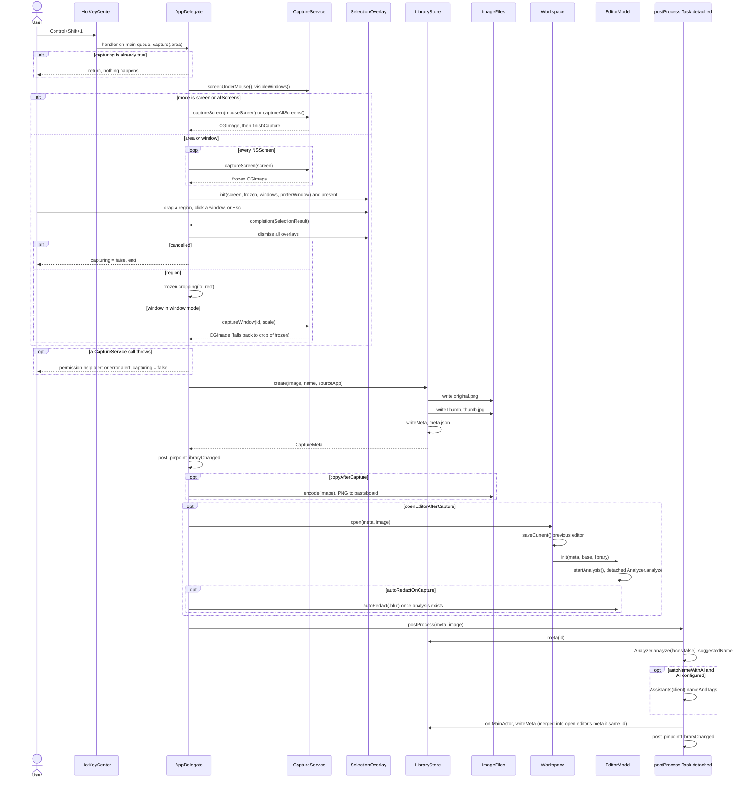
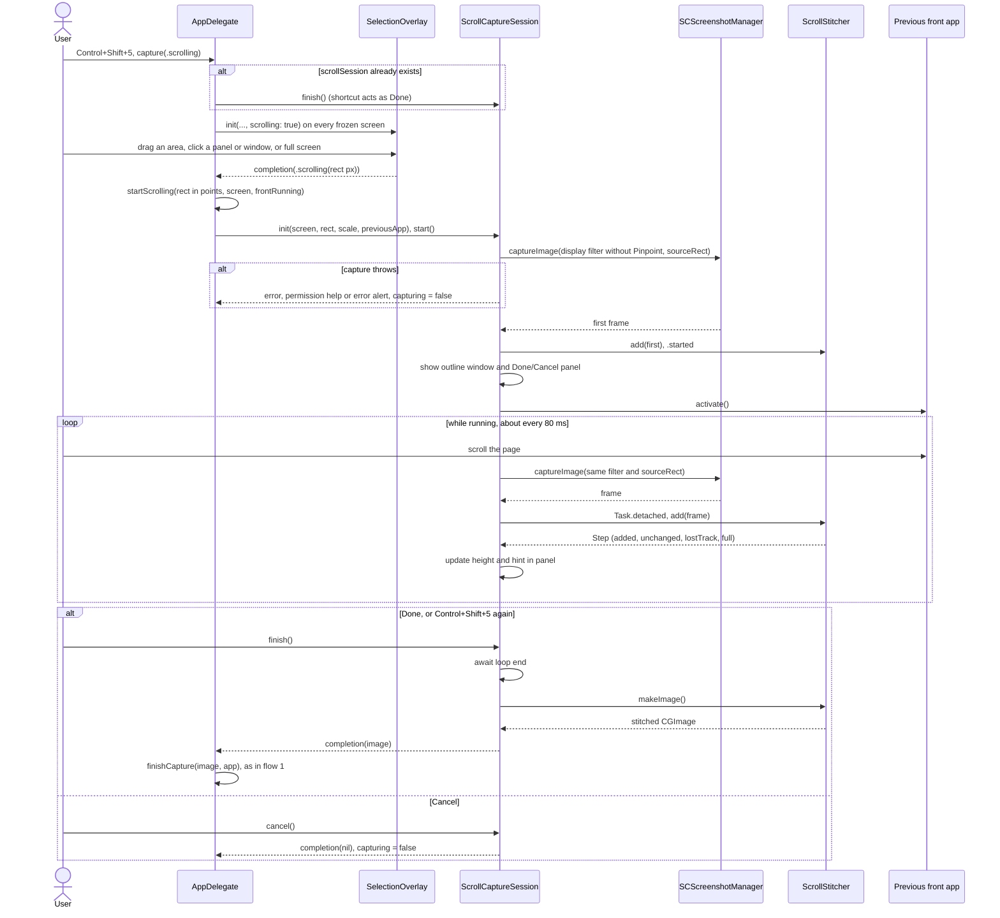
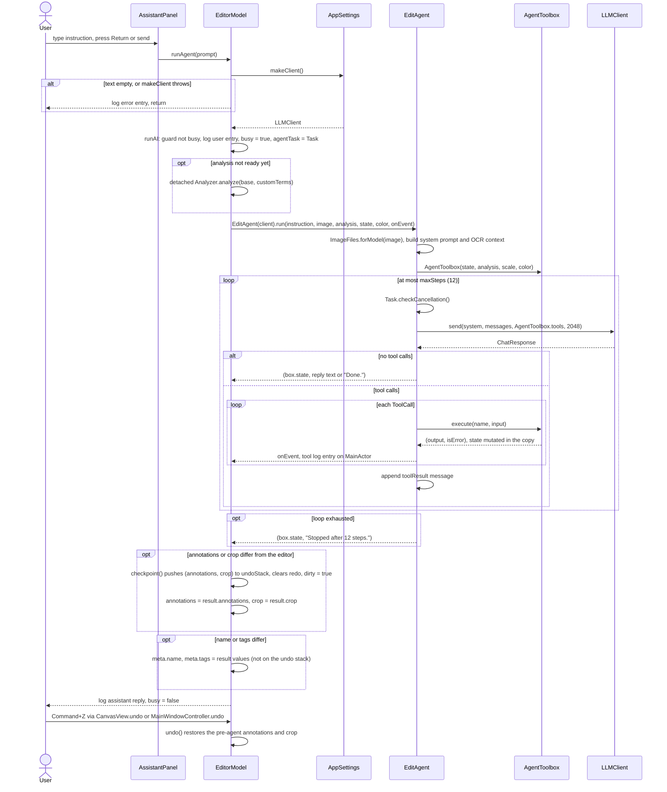
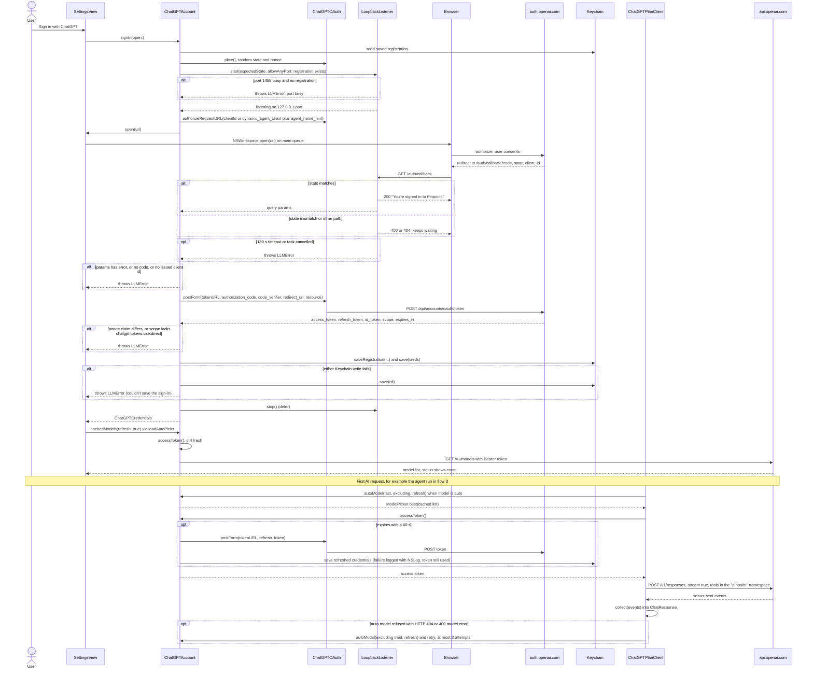

# Flows: Capture, Scrolling Capture, Agent Edit and ChatGPT Sign-In

> Category: Code Graph | Version: 1.0 | Date: November 2026 | Status: Active

For contributors debugging or extending a user journey; traces three journeys call by call through the source with their guards, branches and failure paths.

**Related:**
- [`module-graph.md`](module-graph.md)
- [`type-graph.md`](type-graph.md)
- [`README.md`](README.md)
- [`../architecture/ADR-1-library-folder-per-capture.md`](../architecture/ADR-1-library-folder-per-capture.md)
- [`../architecture/ADR-3-chatgpt-app-registration-name.md`](../architecture/ADR-3-chatgpt-app-registration-name.md)

---

## Why this exists

The type and module graphs say what can call what. These sequence diagrams say what actually happens, in order, for the four journeys people most often ask about. Each was traced by reading the handlers, not by running the app; line numbers point at the code each step comes from. Solid arrows are calls, dashed arrows are returned values, `alt` blocks are mutually exclusive branches and `opt` blocks are optional steps. Nothing here runs in parallel unless it says `Task.detached`.

## 1. Capture: hotkey to saved library entry

This diagram follows **Control+Shift+1** (area or window mode). The full-screen and all-screens modes skip the overlay and go straight to `finishCapture`, which the first `alt` shows. The capture is on disk (`original.png`, `thumb.jpg`, `meta.json` in its own folder, per ADR-1) before the editor opens; OCR naming and AI tags arrive later from a detached task and rewrite `meta.json`.

Source ledger:

| Step | Evidence |
|---|---|
| Hotkey registration and dispatch | `Sources/Pinpoint/AppDelegate.swift:27-32`, `Sources/Pinpoint/HotKeys.swift:11-17`, `:20-32` |
| Re-entry guard, screen and window lists | `AppDelegate.swift:123-131` |
| Screen and all-screens shortcut | `AppDelegate.swift:134-141` |
| Freeze every display, build overlays | `AppDelegate.swift:142-157` |
| Errors and permission help | `AppDelegate.swift:158-162`, `Sources/Pinpoint/CaptureService.swift:29-55` |
| Selection handling | `AppDelegate.swift:166-188`, `Sources/Pinpoint/SelectionOverlay.swift:4-10` |
| Save to library and notify | `AppDelegate.swift:205-210`, `Sources/PinpointCore/Library.swift:57-64`, `:78-86` |
| Copy, open editor, auto-redact | `AppDelegate.swift:211-215`, `:221-225`, `:269-273`, `Sources/Pinpoint/MainWindow.swift:25-30`, `Sources/Pinpoint/EditorModel.swift:136-147`, `:271-285` |
| Background naming and tagging | `AppDelegate.swift:228-262` |

Who hears `.pinpointLibraryChanged`: `LibraryModel` reloads its list (`Sources/Pinpoint/LibraryView.swift:19-21`) and `Workspace` closes the editor if its capture was deleted (`MainWindow.swift:20-22`, `:47-49`). A failure in `create` shows an alert and nothing is saved (`AppDelegate.swift:218`). In the background task, an OCR failure is still absorbed with `try?` (empty analysis); a failed `makeClient`, AI naming call or final `writeMeta` is logged with `NSLog` (`AppDelegate.swift:233`, `:245`, `:258-259`). The capture keeps its offline or placeholder name when AI naming fails. `openImage` collects unreadable or uncreatable files and shows one error alert listing them (`AppDelegate.swift:292-309`).

## 2. Scrolling capture: pick an area, scroll, stitch

This diagram follows **Control+Shift+5** (or the Scrolling Capture menu item, or S in the overlay). It reuses the frozen-screen picker from flow 1; only the pick's result differs. After that the screen is live: Pinpoint grabs the picked rectangle about every 80 ms while the user scrolls by hand, and `ScrollStitcher` joins the frames off the main thread. No Accessibility permission is involved, because Pinpoint never scrolls for the user.

Source ledger:

| Step | Evidence |
|---|---|
| Shortcut, menu items, Done-by-shortcut guard | `Sources/Pinpoint/AppDelegate.swift:31`, `:67`, `:95`, `:115`, `:123-126` |
| Overlay in scrolling mode, S key, toolbar button | `Sources/Pinpoint/SelectionOverlay.swift:8`, `:18`, `:70-76`, `:93-94`, `:311-325`, `:378` |
| Pixel rect to points, session start and errors | `AppDelegate.swift:184-203` |
| First frame, filter without Pinpoint, `sourceRect` | `Sources/Pinpoint/ScrollCaptureSession.swift:34-49` |
| Outline, panel, re-activate previous app | `ScrollCaptureSession.swift:50-53`, `:112-142` |
| Capture loop and detached stitching | `ScrollCaptureSession.swift:54-68` |
| Step messages | `ScrollCaptureSession.swift:91-104` |
| Finish and cancel | `ScrollCaptureSession.swift:72-89`, `AppDelegate.swift:191-195` |
| Matching and committing rows | `Sources/PinpointCore/ScrollStitcher.swift:46-99`, `:109-118` |
| Final image with sticky footer | `ScrollStitcher.swift:101-107` |

While a session is running, `capture(_:)` ignores every other capture request, so the stills modes wait until it ends (`AppDelegate.swift:124-125`). A frame that fails to capture pauses with a warning in the panel and the loop keeps trying (`ScrollCaptureSession.swift:62-65`). `lostTrack` leaves the stitched result as it was; scrolling back up to content the stitcher has already seen lets it pick up again.

## 3. Agent edit: prompt to undoable markup

The edit agent works on a copy of the editor state (`AgentState`) and the editor applies the result only after the run returns. If annotations or crop changed, it records one checkpoint first, so a single undo reverts the whole agent run. A thrown error or cancellation leaves the editor's markup untouched.

Source ledger:

| Step | Evidence |
|---|---|
| Panel submit | `Sources/Pinpoint/EditorView.swift:77-81` |
| Guard, client creation | `Sources/Pinpoint/EditorModel.swift:307-310`, `:332-334`, `Sources/Pinpoint/AppSettings.swift:84-90`, `Sources/PinpointCore/LLM.swift:274-293` |
| runAI busy guard and error handling | `EditorModel.swift:363-373` |
| Analysis fallback | `EditorModel.swift:336-343` |
| Agent loop | `Sources/PinpointCore/Agent.swift:211-252` (`run`; `EditAgent` declared at `:205`) |
| Tool execution | `Agent.swift:83` (`AgentToolbox.execute`), tool specs at `Agent.swift:44` |
| Apply as one undoable step | `EditorModel.swift:349-357`, `:152-162` |
| Undo entry points | `Sources/Pinpoint/CanvasView.swift:272`, `Sources/Pinpoint/MainWindow.swift:138`, `:445` |

Cancellation: the stop button calls `cancelAI()` (`EditorModel.swift:361`), which cancels `agentTask`; the loop's `Task.checkCancellation()` throws `CancellationError`, which `runAI` swallows without logging an error. Name and tag changes from the agent are not part of the undo snapshot, which stores only `(annotations, crop)` (`EditorModel.swift:132-133`).

## 4. ChatGPT sign-in to first request

Sign-in is OAuth authorization code with PKCE against `auth.openai.com`, using dynamic app registration under the name "Pinpoint" (ADR-3) and a one-shot HTTP listener on `127.0.0.1` for the redirect. Tokens and the registration are stored in the Keychain. The first model request then goes to `https://api.openai.com/v1/responses` with the access token, refreshing it when it is within a minute of expiry.

Source ledger:

| Step | Evidence |
|---|---|
| Settings button and status | `Sources/Pinpoint/SettingsView.swift:172-190`, `:139-146` |
| PKCE, state, nonce, listener start | `Sources/PinpointCore/ChatGPTPlan.swift:153-160`, `:42-46`, `:265-271` |
| Authorize URL and browser open | `ChatGPTPlan.swift:161-163`, `:48-68` |
| Callback handling | `ChatGPTPlan.swift:305-326`, `:333-347` |
| Error, code and client id checks | `ChatGPTPlan.swift:164-173` |
| Token exchange, nonce and scope checks | `ChatGPTPlan.swift:174-185`, `:89-103` |
| Keychain storage | `ChatGPTPlan.swift:127-142`, `:190-193`, `Sources/PinpointCore/Assistants.swift:155-175` |
| Model list | `ChatGPTPlan.swift:238-248`, `:548-558` |
| Client creation for the first request | `Sources/Pinpoint/AppSettings.swift:84-90`, `Sources/PinpointCore/LLM.swift:275-279` |
| Auto model, token refresh, request | `ChatGPTPlan.swift:453-468`, `:198-229`, `:466-495`, `:560-564` |

A concurrent refresh is shared: `accessToken()` reuses one in-flight `refreshTask` under a lock (`ChatGPTPlan.swift:201-208`). A failed refresh surfaces as "Your ChatGPT sign-in expired" and does not clear the stored credentials (`ChatGPTPlan.swift:225-227`). The JWT is decoded without a signature check, as its doc comment states (`ChatGPTPlan.swift:70-78`).

## What these flows leave out

Drawing markup by hand on the canvas, voice notes, the library guide builder, export and handoff, the Codex CLI provider and the Anthropic or OpenAI-compatible request formats are not traced. None of these diagrams was checked by running the app; they are a reading of the source at the commit in [`README.md`](README.md).
