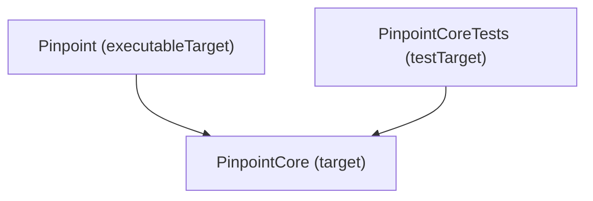
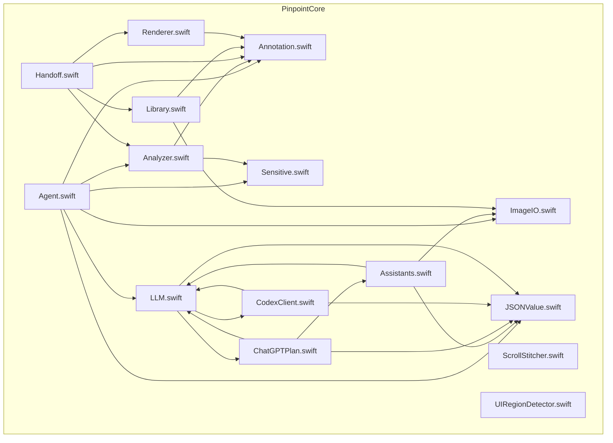
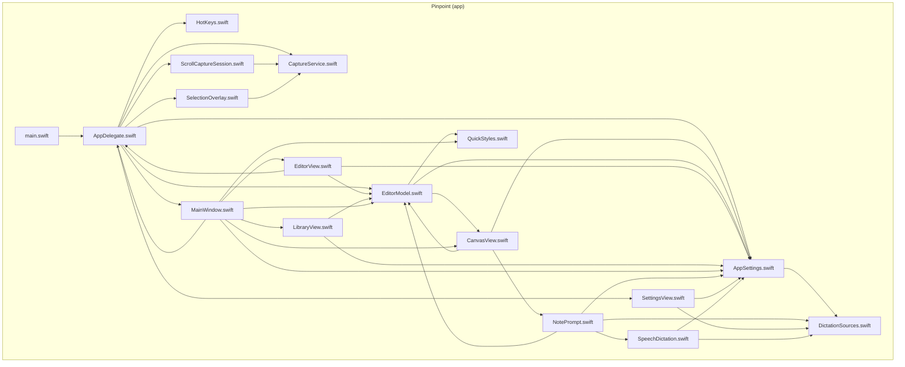
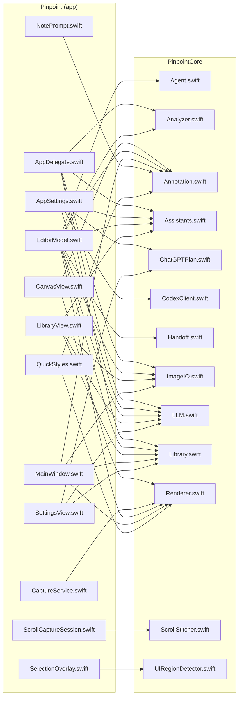

# Module Graph: File-Level Dependencies

> Category: Code Graph | Version: 1.0 | Date: November 2026 | Status: Active

For contributors who need to know which Swift file leans on which before moving or changing a type; covers every file in `Sources/PinpointCore/` and `Sources/Pinpoint/`.

**Related:**
- [`type-graph.md`](type-graph.md)
- [`flows.md`](flows.md)
- [`README.md`](README.md)
- [`../architecture/ADR-1-library-folder-per-capture.md`](../architecture/ADR-1-library-folder-per-capture.md)
- [`../architecture/ADR-2-stored-data-identifiers.md`](../architecture/ADR-2-stored-data-identifiers.md)

---

## Why this exists

Pinpoint is split into two Swift Package Manager targets so that the logic can be unit-tested without the app. `PinpointCore` is a library with no UI shell; `Pinpoint` is the executable that owns windows, hotkeys and capture. The rule that keeps this split useful is one-way: the app imports the core, and the core never refers to anything in the app. The graphs below show that the rule holds today and where the heavier couplings sit.

An arrow `A --> B` means "a file in A names a type, free function or static member that is declared in B". It is a compile-time reference, not a runtime call order. Edges were derived mechanically (see [`README.md`](README.md)) and each one is listed with the symbol and line that proves it in the tables at the end.

## Target level

`Package.swift` declares three targets. The executable and the test target both depend on the core; nothing depends on the executable.

Source: `Package.swift` lines 8-12. Thirteen of the seventeen app files carry `import PinpointCore`; no core file imports the app module, and no core file names an app-declared type (0 core-to-app edges in the derived set).

## Inside PinpointCore

Fifteen files, 26 edges. `Annotation.swift`, `LLM.swift` and `JSONValue.swift` are the most depended-on. Two two-way couplings exist: `LLM.swift` builds `ChatGPTPlanClient` and `CodexClient` in `ProviderSettings.makeClient` (`LLM.swift:274-293`), while those clients conform to the `LLMClient` protocol declared in `LLM.swift`. `UIRegionDetector.swift` and `ScrollStitcher.swift` have no edges inside the core; only the app's `SelectionOverlay.swift` and `ScrollCaptureSession.swift` use them.

## Inside the Pinpoint app target

Seventeen files, 38 edges. `AppDelegate.swift` is the hub that `main.swift` starts. `AppSettings.swift` (the `AppSettings.shared` singleton) is used by nine files. Two files point back up at `AppDelegate.swift` through `AppDelegate.shared` (`EditorView.swift` and `MainWindow.swift`), and `EditorModel.swift` and `CanvasView.swift` reference each other (the model keeps a weak `canvas`, the view keeps its `model`).

`main.swift` and `HotKeys.swift` have no PinpointCore edges. `DictationSources.swift`, `EditorView.swift` and `SpeechDictation.swift` reach the core only indirectly, through other app files.

## App to core

Thirty-seven edges from twelve app files into thirteen core files. Every arrow crosses in the same direction. `EditorModel.swift` is the widest consumer (nine core files), which matches its role as the editor's state and command object.

`JSONValue.swift` and `Sensitive.swift` are not named directly by any app file.

## Edge ledger

Line numbers are the first line in the From file where the symbol appears outside a comment or string literal. They reflect commit `d4cea7c` plus the uncommitted scrolling-capture files described in [`README.md`](README.md).

### PinpointCore to PinpointCore (26)

| From | To | Symbols used (first line in the From file) |
|---|---|---|
| `Agent.swift` | `Analyzer.swift` | Analysis (L20), Analyzer (L145) |
| `Agent.swift` | `Annotation.swift` | Annotation (L6), AnnotationKind (L126), RGBA (L22) |
| `Agent.swift` | `ImageIO.swift` | ImageFiles (L213) |
| `Agent.swift` | `JSONValue.swift` | JSONValue (L83) |
| `Agent.swift` | `LLM.swift` | ChatMessage (L236), ChatPart (L243), LLMClient (L206), ToolSpec (L44) |
| `Agent.swift` | `Sensitive.swift` | SensitiveKind (L65) |
| `Analyzer.swift` | `Annotation.swift` | Annotation (L72), AnnotationKind (L71) |
| `Analyzer.swift` | `Sensitive.swift` | SensitiveDetector (L43), SensitiveKind (L72), SensitiveRegion (L13) |
| `Assistants.swift` | `ImageIO.swift` | ImageFiles (L11) |
| `Assistants.swift` | `JSONValue.swift` | extractJSONObject (L30) |
| `Assistants.swift` | `LLM.swift` | LLMClient (L7), LLMError (L31) |
| `ChatGPTPlan.swift` | `Assistants.swift` | Keychain (L119) |
| `ChatGPTPlan.swift` | `JSONValue.swift` | JSONValue (L71) |
| `ChatGPTPlan.swift` | `LLM.swift` | ChatMessage (L366), ChatPart (L446), ChatResponse (L412), LLMClient (L357), LLMError (L100), ToolSpec (L366), perform (L243) |
| `CodexClient.swift` | `JSONValue.swift` | JSONValue (L37), extractJSONObject (L76) |
| `CodexClient.swift` | `LLM.swift` | ChatMessage (L50), ChatPart (L79), ChatResponse (L74), LLMClient (L6), LLMError (L117), ToolSpec (L50) |
| `Handoff.swift` | `Analyzer.swift` | OCRLine (L7) |
| `Handoff.swift` | `Annotation.swift` | Annotation (L7) |
| `Handoff.swift` | `Library.swift` | CaptureMeta (L45) |
| `Handoff.swift` | `Renderer.swift` | Renderer (L46) |
| `LLM.swift` | `ChatGPTPlan.swift` | ChatGPTAccount (L276), ChatGPTPlanClient (L278), ModelPicker (L278) |
| `LLM.swift` | `CodexClient.swift` | CodexClient (L281) |
| `LLM.swift` | `JSONValue.swift` | JSONValue (L10) |
| `Library.swift` | `Annotation.swift` | Annotation (L17) |
| `Library.swift` | `ImageIO.swift` | ImageFiles (L60) |
| `Renderer.swift` | `Annotation.swift` | Annotation (L32), RGBA (L202) |

### Pinpoint to Pinpoint (38)

| From | To | Symbols used (first line in the From file) |
|---|---|---|
| `AppDelegate.swift` | `AppSettings.swift` | AppSettings (L207) |
| `AppDelegate.swift` | `CaptureService.swift` | CaptureService (L128) |
| `AppDelegate.swift` | `EditorModel.swift` | EditorModel (L221), pinpointLibraryChanged (L210) |
| `AppDelegate.swift` | `HotKeys.swift` | HotKeyCenter (L27) |
| `AppDelegate.swift` | `MainWindow.swift` | MainWindowController (L15), Workspace (L14) |
| `AppDelegate.swift` | `ScrollCaptureSession.swift` | ScrollCaptureSession (L19) |
| `AppDelegate.swift` | `SelectionOverlay.swift` | SelectionOverlay (L17), SelectionResult (L166) |
| `AppDelegate.swift` | `SettingsView.swift` | SettingsView (L318) |
| `AppSettings.swift` | `DictationSources.swift` | ExternalDictation (L31) |
| `CanvasView.swift` | `AppSettings.swift` | AppSettings (L130) |
| `CanvasView.swift` | `EditorModel.swift` | EditorModel (L12), Tool (L263) |
| `CanvasView.swift` | `NotePrompt.swift` | NotePromptView (L210) |
| `EditorModel.swift` | `AppSettings.swift` | AppSettings (L273) |
| `EditorModel.swift` | `CanvasView.swift` | CanvasView (L70), ZoomController (L68) |
| `EditorModel.swift` | `QuickStyles.swift` | QuickStyle (L192) |
| `EditorView.swift` | `AppDelegate.swift` | AppDelegate (L71) |
| `EditorView.swift` | `AppSettings.swift` | AppSettings (L7) |
| `EditorView.swift` | `EditorModel.swift` | EditorModel (L6), LogEntry (L85) |
| `LibraryView.swift` | `AppSettings.swift` | AppSettings (L69) |
| `LibraryView.swift` | `EditorModel.swift` | pinpointLibraryChanged (L19) |
| `MainWindow.swift` | `AppDelegate.swift` | AppDelegate (L82) |
| `MainWindow.swift` | `AppSettings.swift` | AppSettings (L54) |
| `MainWindow.swift` | `CanvasView.swift` | CanvasScrollView (L189), ZoomController (L405) |
| `MainWindow.swift` | `EditorModel.swift` | EditorModel (L11), Tool (L122), pinpointLibraryChanged (L20) |
| `MainWindow.swift` | `EditorView.swift` | AssistantPanel (L198) |
| `MainWindow.swift` | `LibraryView.swift` | LibraryModel (L10), LibraryView (L62) |
| `MainWindow.swift` | `QuickStyles.swift` | QuickStyle (L239) |
| `NotePrompt.swift` | `AppSettings.swift` | AppSettings (L69) |
| `NotePrompt.swift` | `DictationSources.swift` | ExternalDictation (L19) |
| `NotePrompt.swift` | `EditorModel.swift` | EditorModel (L7) |
| `NotePrompt.swift` | `SpeechDictation.swift` | SpeechDictation (L8) |
| `ScrollCaptureSession.swift` | `CaptureService.swift` | CaptureError (L37), CaptureService (L36) |
| `SelectionOverlay.swift` | `CaptureService.swift` | CaptureService (L122), WindowInfo (L6) |
| `SettingsView.swift` | `AppSettings.swift` | AppSettings (L6) |
| `SettingsView.swift` | `DictationSources.swift` | AudioInputs (L96), ExternalDictation (L86) |
| `SpeechDictation.swift` | `AppSettings.swift` | AppSettings (L56) |
| `SpeechDictation.swift` | `DictationSources.swift` | AudioInputs (L57) |
| `main.swift` | `AppDelegate.swift` | AppDelegate (L4) |

### Pinpoint to PinpointCore (37)

| From | To | Symbols used (first line in the From file) |
|---|---|---|
| `AppDelegate.swift` | `Analyzer.swift` | Analysis (L238), Analyzer (L238) |
| `AppDelegate.swift` | `Assistants.swift` | Assistants (L243) |
| `AppDelegate.swift` | `ImageIO.swift` | ImageFiles (L211) |
| `AppDelegate.swift` | `LLM.swift` | LLMClient (L231), LLMError (L308) |
| `AppDelegate.swift` | `Library.swift` | CaptureMeta (L228), LibraryStore (L12) |
| `AppSettings.swift` | `Assistants.swift` | Keychain (L65) |
| `AppSettings.swift` | `ChatGPTPlan.swift` | ChatGPTAccount (L74), ChatGPTPlanClient (L87), ModelPicker (L44) |
| `AppSettings.swift` | `CodexClient.swift` | CodexClient (L75) |
| `AppSettings.swift` | `LLM.swift` | LLMClient (L84), LLMError (L86), ProviderKind (L10), ProviderSettings (L11) |
| `CanvasView.swift` | `Annotation.swift` | Annotation (L16) |
| `CanvasView.swift` | `Renderer.swift` | Renderer (L54) |
| `CaptureService.swift` | `Renderer.swift` | Renderer (L127) |
| `EditorModel.swift` | `Agent.swift` | AgentState (L344), EditAgent (L345) |
| `EditorModel.swift` | `Analyzer.swift` | Analysis (L127), Analyzer (L275) |
| `EditorModel.swift` | `Annotation.swift` | Annotation (L52), AnnotationKind (L34), RGBA (L55) |
| `EditorModel.swift` | `Assistants.swift` | Assistants (L315) |
| `EditorModel.swift` | `Handoff.swift` | Handoff (L93) |
| `EditorModel.swift` | `ImageIO.swift` | ImageFiles (L118) |
| `EditorModel.swift` | `LLM.swift` | LLMClient (L307) |
| `EditorModel.swift` | `Library.swift` | CaptureMeta (L51), LibraryStore (L48) |
| `EditorModel.swift` | `Renderer.swift` | Renderer (L119) |
| `LibraryView.swift` | `Assistants.swift` | Assistants (L78), GuideBuilder (L104), GuideStep (L92) |
| `LibraryView.swift` | `ImageIO.swift` | ImageFiles (L47) |
| `LibraryView.swift` | `LLM.swift` | LLMClient (L68) |
| `LibraryView.swift` | `Library.swift` | CaptureMeta (L8), LibraryStore (L7) |
| `MainWindow.swift` | `Annotation.swift` | AnnotationKind (L231), RGBA (L332) |
| `MainWindow.swift` | `ImageIO.swift` | ImageFiles (L176) |
| `MainWindow.swift` | `Library.swift` | CaptureMeta (L25), LibraryStore (L9) |
| `MainWindow.swift` | `Renderer.swift` | Renderer (L453) |
| `NotePrompt.swift` | `Annotation.swift` | Annotation (L23) |
| `QuickStyles.swift` | `Annotation.swift` | Annotation (L56), AnnotationKind (L13), RGBA (L6) |
| `QuickStyles.swift` | `Renderer.swift` | Renderer (L65) |
| `ScrollCaptureSession.swift` | `ScrollStitcher.swift` | ScrollStitcher (L21) |
| `SelectionOverlay.swift` | `UIRegionDetector.swift` | UIRegionDetector (L89) |
| `SettingsView.swift` | `ChatGPTPlan.swift` | ChatGPTAccount (L132), ModelPicker (L122) |
| `SettingsView.swift` | `LLM.swift` | ProviderKind (L23), ProviderSettings (L15) |
| `SettingsView.swift` | `Library.swift` | LibraryStore (L110) |

## What the graph leaves out

System frameworks (AppKit, SwiftUI, Vision, ScreenCaptureKit, Network, CryptoKit and others) are not drawn. One candidate edge was rejected after inspection: the name `perform` in `SelectionOverlay.swift:311` is a private method there, not the internal `perform(_:session:)` in `LLM.swift:62`, which the app could not call anyway. Nested types that share a name across files (two `Coordinator` classes, in `CanvasView.swift:356` and `MainWindow.swift:170`) were excluded from matching so they do not create false edges.
