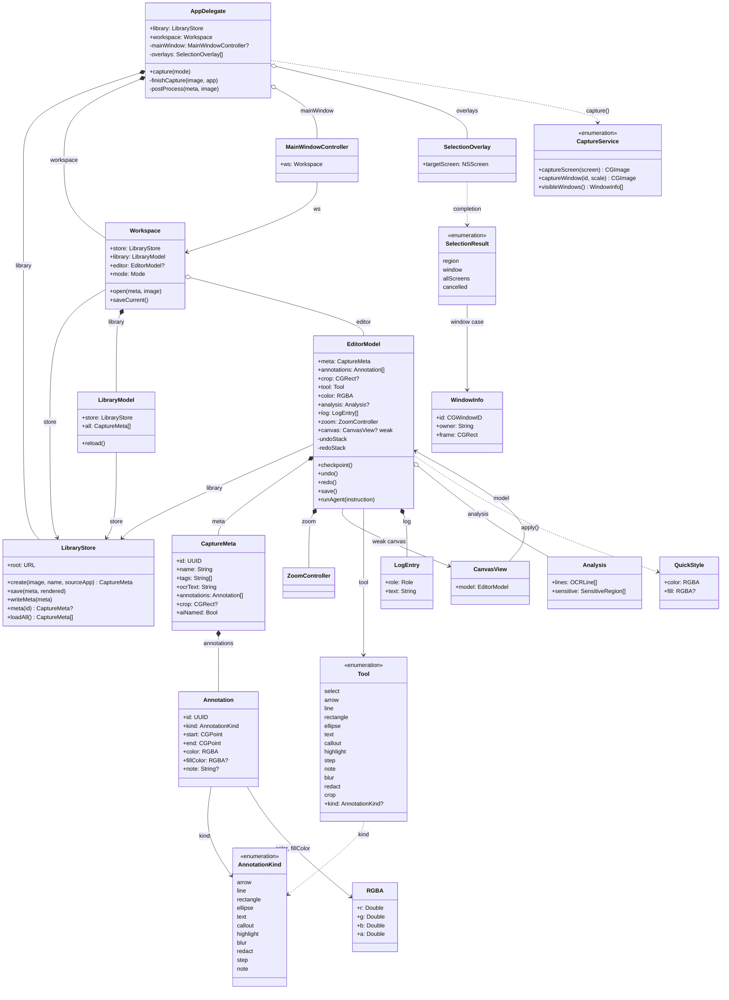

# Type Graph: Key Types and Relationships

> Category: Code Graph | Version: 1.0 | Date: November 2026 | Status: Active

For contributors changing the data model, the editor or the AI layer; shows who owns what, which types conform to `LLMClient`, and the enums that drive markup and provider choice.

**Related:**
- [`module-graph.md`](module-graph.md)
- [`flows.md`](flows.md)
- [`README.md`](README.md)
- [`../architecture/ADR-1-library-folder-per-capture.md`](../architecture/ADR-1-library-folder-per-capture.md)
- [`../architecture/ADR-2-stored-data-identifiers.md`](../architecture/ADR-2-stored-data-identifiers.md)
- [`../architecture/ADR-3-chatgpt-app-registration-name.md`](../architecture/ADR-3-chatgpt-app-registration-name.md)

---

## Why this exists

Pinpoint has about a hundred declared types, but a small set carries the design: one capture record (`CaptureMeta`) that holds its markup (`Annotation`), an editor model that turns user and agent actions into undoable changes, and a provider-neutral `LLMClient` protocol with four implementations. The two class diagrams below cover those types only. Fields and methods are trimmed to the ones that explain a relationship; every listed member exists in the cited file.

Arrow meanings, using Mermaid class notation:

| Notation | Meaning in this doc |
|---|---|
| `A *-- B` | A stores B as a stored property and B is part of A's value or lifetime (composition) |
| `A o-- B` | A holds an optional or replaceable B (aggregation) |
| `A --> B` | A stores a reference to B (association) |
| `A ..> B` | A uses or creates B inside a method, without storing it (dependency) |
| `A ..|> B` | A conforms to protocol B |

## Diagram 1: capture data, editor and app ownership

The app delegate owns the single `LibraryStore` and the `Workspace`, which in turn owns the library list model and at most one open `EditorModel`. The editor copies a capture's annotations out of `CaptureMeta`, edits them with an undo stack, and writes them back on save. 20 classes, 25 relationships.

Sources: `AppDelegate` at `Sources/Pinpoint/AppDelegate.swift:9-18`; `Workspace` and `MainWindowController` at `Sources/Pinpoint/MainWindow.swift:7-13` and `:417-418`; `LibraryModel` at `Sources/Pinpoint/LibraryView.swift:6-8`; `EditorModel`, `Tool`, `LogEntry` at `Sources/Pinpoint/EditorModel.swift:6-70` and `:127-134`; `CanvasView` and `ZoomController` at `Sources/Pinpoint/CanvasView.swift:7-8` and `:293`; `QuickStyle` at `Sources/Pinpoint/QuickStyles.swift:5-7`; `SelectionResult` and `SelectionOverlay` at `Sources/Pinpoint/SelectionOverlay.swift:4-14`; `WindowInfo` and `CaptureService` at `Sources/Pinpoint/CaptureService.swift:5-25`; `CaptureMeta` and `LibraryStore` at `Sources/PinpointCore/Library.swift:6-31`; `RGBA`, `AnnotationKind`, `Annotation` at `Sources/PinpointCore/Annotation.swift:5-58`; `Analysis` at `Sources/PinpointCore/Analyzer.swift:11-13`.

`Tool` is an app-side editor tool, not part of the stored format. Its `kind` property maps to `AnnotationKind` by raw value (`EditorModel.swift:34`), so `select`, `crop` map to `nil` and every other tool maps to the kind with the same name. `CaptureMeta` is what `LibraryStore` encodes to `meta.json` (`Library.swift:78-81`); the editor's undo stack holds `([Annotation], CGRect?)` pairs (`EditorModel.swift:132-133`) and is never persisted.

## Diagram 2: AI providers, the edit agent and analysis

All AI traffic goes through the `LLMClient` protocol (`LLM.swift:51-53`), which has one requirement, `send(system:messages:tools:maxTokens:)`. `ProviderSettings.makeClient` picks the implementation from `ProviderKind`. The edit agent and the one-shot `Assistants` helpers only know the protocol. 30 classes, 37 relationships.

```mermaid
classDiagram
    direction TB
    class LLMClient {
        <<interface>>
        +send(system, messages, tools, maxTokens) ChatResponse
        +ask(system, prompt, images, maxTokens) String
    }
    class AnthropicClient {
        +apiKey: String
        +model: String
        +baseURL: URL
    }
    class OpenAICompatibleClient {
        +apiKey: String
        +model: String
        +baseURL: URL
    }
    class ChatGPTPlanClient {
        +model: String
        +account: ChatGPTAccount
    }
    class CodexClient {
        +executable: URL
        +model: String
        +locate(explicit) URL?
    }
    class ChatGPTAccount {
        +shared: ChatGPTAccount
        -cached: ChatGPTCredentials?
        +signIn(open) ChatGPTCredentials
        +accessToken() String
        +signOut()
        +models() String[]
        +autoModel(fast, excluding, refresh) String
    }
    class ChatGPTCredentials {
        +accessToken: String
        +refreshToken: String
        +expiresAt: Date
        +clientId: String
    }
    class ChatGPTOAuth {
        <<enumeration>>
        +pkce() verifier, challenge
        +authorizeRequestURL(...) URL
        +postForm(url, fields) JSONValue
    }
    class LoopbackListener {
        +port: UInt16
        +start(expectedState, allowAnyPort)
        +waitForCallback(timeout)
        +stop()
    }
    class ModelPicker {
        <<enumeration>>
        +isAuto(m) Bool
        +best(ids, fast) String?
    }
    class Keychain {
        <<enumeration>>
        +service: String
        +get(account) String
        +set(value, account) Bool
    }
    class ProviderKind {
        <<enumeration>>
        chatgpt
        codex
        anthropic
        openai
        openrouter
        gemini
        ollama
        custom
    }
    class ProviderSettings {
        +kind: ProviderKind
        +model: String
        +baseURL: String
        +makeClient(apiKey) LLMClient
    }
    class AppSettings {
        +shared: AppSettings
        +provider: ProviderKind
        +providers: ProviderKind to ProviderSettings
        +makeClient(fast) LLMClient
    }
    class EditAgent {
        +client: LLMClient
        +maxSteps: Int
        +run(instruction, image, analysis, state, color, onEvent)
    }
    class AgentToolbox {
        +state: AgentState
        +analysis: Analysis
        +tools: ToolSpec[]
        +execute(name, input)
    }
    class AgentState {
        +annotations: Annotation[]
        +crop: CGRect?
        +name: String
        +tags: String[]
    }
    class Assistants {
        +client: LLMClient
        +summarize(image, ocrText) String
        +nameAndTags(image, ocrText, app)
    }
    class ChatMessage {
        +role: ChatRole
        +parts: ChatPart[]
    }
    class ChatRole {
        <<enumeration>>
        user
        assistant
    }
    class ChatPart {
        <<enumeration>>
        text
        image
        toolUse
        toolResult
    }
    class ChatResponse {
        +parts: ChatPart[]
        +toolCalls: ToolCall[]
    }
    class ToolSpec {
        +name: String
        +parameters: JSONValue
    }
    class JSONValue {
        <<enumeration>>
    }
    class Analyzer {
        <<enumeration>>
        +analyze(image, faces, customTerms) Analysis
        +redactions(regions, style, imageSize) Annotation[]
    }
    class Analysis {
        +lines: OCRLine[]
        +sensitive: SensitiveRegion[]
    }
    class OCRLine {
        +text: String
        +rect: CGRect
    }
    class SensitiveRegion {
        +kind: SensitiveKind
        +rect: CGRect
    }
    class SensitiveKind {
        <<enumeration>>
        email
        apiKey
        accountID
        phone
        creditCard
        ipAddress
        ssn
        custom
        face
    }
    class Annotation

    AnthropicClient ..|> LLMClient
    OpenAICompatibleClient ..|> LLMClient
    ChatGPTPlanClient ..|> LLMClient
    CodexClient ..|> LLMClient
    ChatGPTPlanClient --> ChatGPTAccount : account
    ChatGPTPlanClient ..> ModelPicker : auto model
    ChatGPTAccount o-- ChatGPTCredentials : cached
    ChatGPTAccount ..> ChatGPTOAuth : signIn, refresh
    ChatGPTAccount ..> LoopbackListener : signIn
    ChatGPTAccount ..> Keychain : credentials
    ChatGPTAccount ..> ModelPicker : autoModel
    ProviderSettings --> ProviderKind : kind
    ProviderSettings ..> AnthropicClient : makeClient
    ProviderSettings ..> OpenAICompatibleClient : makeClient
    ProviderSettings ..> ChatGPTPlanClient : makeClient
    ProviderSettings ..> CodexClient : makeClient
    AppSettings *-- ProviderSettings : providers
    AppSettings --> ProviderKind : provider
    AppSettings ..> Keychain : API keys
    EditAgent --> LLMClient : client
    EditAgent ..> AgentToolbox : run
    AgentToolbox *-- AgentState : state
    AgentToolbox *-- Analysis : analysis
    AgentToolbox ..> ToolSpec : tools
    AgentState *-- Annotation : annotations
    Assistants --> LLMClient : client
    LLMClient ..> ChatMessage : send
    LLMClient ..> ChatResponse : send
    LLMClient ..> ToolSpec : send
    ChatMessage --> ChatRole : role
    ChatMessage *-- ChatPart : parts
    ChatResponse *-- ChatPart : parts
    ChatPart ..> JSONValue : toolUse input
    Analyzer ..> Analysis : analyze
    Analysis *-- OCRLine : lines
    Analysis *-- SensitiveRegion : sensitive
    SensitiveRegion --> SensitiveKind : kind
```

Sources: `LLMClient`, `AnthropicClient`, `OpenAICompatibleClient` at `Sources/PinpointCore/LLM.swift:51-60`, `:77-81`, `:139-143`; chat types at `LLM.swift:5-43`; `ProviderKind` and `ProviderSettings.makeClient` at `LLM.swift:222-293`; `ChatGPTCredentials`, `ChatGPTOAuth`, `ChatGPTAccount`, `LoopbackListener`, `ChatGPTPlanClient`, `ModelPicker` at `Sources/PinpointCore/ChatGPTPlan.swift:9`, `:19`, `:107`, `:247`, `:347-352`, `:493`; `ChatGPTAccount.autoModel` at `ChatGPTPlan.swift:558-562`; `CodexClient` at `Sources/PinpointCore/CodexClient.swift:6-9`; `Keychain` and `Assistants` at `Sources/PinpointCore/Assistants.swift:155` and `:6-8`; `AgentState`, `AgentToolbox`, `EditAgent` at `Sources/PinpointCore/Agent.swift:5-44` and `:205-209`; `Analysis`, `OCRLine`, `Analyzer` at `Sources/PinpointCore/Analyzer.swift:5-20` and `:71`; `SensitiveKind`, `SensitiveRegion` at `Sources/PinpointCore/Sensitive.swift:4-27`; `AppSettings` at `Sources/Pinpoint/AppSettings.swift:6-11` and `:80-86`.

Two details the diagram cannot show on its own. First, `AppSettings.makeClient(fast:)` skips `ProviderSettings` for one case: with ChatGPT on Auto it builds `ChatGPTPlanClient(model: ModelPicker.autoFast)` directly (`AppSettings.swift:81-84`). Second, `AgentToolbox` is "pure (no network)" per its doc comment (`Agent.swift:16`); it never touches `LLMClient`, which is why it is unit-tested directly.

## What the graph leaves out

Rendering (`Renderer`), on-device detectors (`SensitiveDetector`, `UIRegionDetector`), image helpers (`ImageFiles`), `Handoff`, `GuideBuilder`, dictation (`SpeechDictation`, `ExternalDictation`, `AudioInputs`) and SwiftUI view structs are omitted to stay readable; they are stateless helpers or views whose file-level links appear in [`module-graph.md`](module-graph.md). The `JSONValue` cases and `ToolCall` fields are not expanded.
