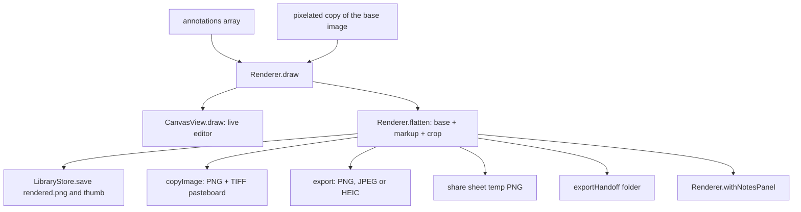
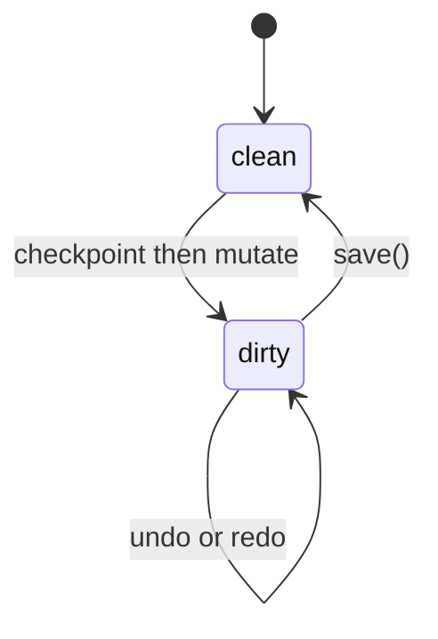

# Markup and Rendering

> Category: Editor | Version: 1.0 | Date: November 2026 | Status: Active

For contributors changing the editor: the markup item data model and its coordinate system, the single renderer used by both the live canvas and every exported image, and how the editor model handles undo, crop, saving and export.

**Related:**
- [`../capture/capture-pipeline.md`](../capture/capture-pipeline.md)
- [`../analysis/analysis-and-redaction.md`](../analysis/analysis-and-redaction.md)
- [`../ai/agent-and-providers.md`](../ai/agent-and-providers.md)
- [`../storage/library-and-handoff.md`](../storage/library-and-handoff.md)
- [`../glossary/glossary.md`](../glossary/glossary.md)
- [`../architecture/ADR-1-library-folder-per-capture.md`](../architecture/ADR-1-library-folder-per-capture.md)

---

## Why one renderer

What you see on the canvas must be what you get when you copy, save or export. Pinpoint guarantees this by drawing markup with one function, `Renderer.draw` (`Sources/PinpointCore/Renderer.swift`), in one coordinate space. The canvas calls it inside its view's `draw(_:)`, and `Renderer.flatten` calls it into an offscreen bitmap. Because the renderer lives in `PinpointCore`, it can be tested without the app.



---

## The markup item model

A markup item is an `Annotation` (`Sources/PinpointCore/Annotation.swift`). It is `Codable` and stored inside each capture's `meta.json`, so its field names and the raw values of `AnnotationKind` are a stored format ([ADR-1](../architecture/ADR-1-library-folder-per-capture.md)).

```swift
public struct Annotation: Codable, Identifiable, Equatable, Sendable {
    public var id: UUID
    public var kind: AnnotationKind
    public var start: CGPoint
    public var end: CGPoint
    public var color: RGBA
    public var lineWidth: Double
    public var text: String?
    public var fontSize: Double
    public var fillColor: RGBA?   // rectangles, ellipses, callouts; nil = no fill
    public var shadow: Bool?      // nil = default (on)
    public var note: String?      // context shown as a numbered badge, exported in handoffs
}
```

### Coordinates

All geometry is in **image pixels with a top-left origin**. The canvas's view coordinate space is the image's pixel size (`CanvasView` is created with a frame equal to `model.imageSize`), and the enclosing scroll view handles zoom through magnification. Because markup never stores view or screen coordinates, it looks identical at any zoom and in exports.

`start` and `end` mean different things per kind:

| Kind | Geometry |
|---|---|
| `arrow`, `line` | `start` is the tail, `end` is the head |
| `rectangle`, `ellipse`, `callout`, `highlight`, `blur`, `redact` | Opposite corners of a box (`isBox`); `rect` normalises them |
| `text` | `start` is the top-left of the text |
| `step`, `note` | `start` is the centre of the badge or pin |

`RGBA` stores sRGB components and offers eight presets (red, orange, yellow, green, blue, purple, black, white). `RGBA.parse` accepts those names or a six-digit hex string, which the agent tools use.

### Kinds

`AnnotationKind` has eleven cases: arrow, line, rectangle, ellipse, text, callout, highlight, blur, redact, step and note. Only rectangle, ellipse and callout support fill. Helper properties drive hit testing and badge placement: `bounds` includes stroke, arrow head, text size, step radius or the callout tail; `hitTest` uses distance to the segment for arrows and lines and padded bounds otherwise; `badgeAnchor` and `target` give the point a note badge sits at and the area a handoff describes.

`defaultLineWidth(for:)` and `defaultFontSize(for:)` scale with the image's longer side (minimums 3 and 18) so markup looks the same on 1x and Retina captures.

### Notes and numbering

`hasNote` is true for every `.note` pin and for any other item with a non-blank `note`. `Renderer.noteNumbers` numbers those items 1, 2, 3 in drawing order. Note pins draw their number inside the pin; other items with a note get a separate numbered badge, clamped inside the image. Steps are numbered independently: a new step gets one more than the highest existing step number (`EditorModel.nextStep`).

---

## How each kind is drawn

`Renderer.draw(_:in:imageSize:pixelated:)` assumes a flipped context in image pixels. Line caps and joins are round, and kinds that honour `hasShadow` get a soft black shadow scaled to the line width.

| Kind | Drawing |
|---|---|
| line | Stroked segment |
| arrow | Shaft stopped short of the head, then a filled triangular head sized by `arrowHeadLength` |
| rectangle | Rounded rect, optional fill, stroke if line width is above 0 |
| ellipse | Optional fill, stroke if line width is above 0 |
| callout | Rounded bubble plus tail, filled with the fill colour or the main colour, centred wrapped text in black or white by luminance |
| highlight | Multiply blend fill at 45% alpha |
| redact | Solid fill (black by default) |
| blur | Clips to the box and draws the pre-pixelated image; grey fill if no pixelated copy exists |
| note | Speech-bubble pin with its number |
| step | Filled circle with white ring and its label |
| text | Bold system font with a contrasting outline stroke |

**Blur is pixelation.** `Renderer.pixelated` runs `CIPixellate` over the whole image once, with a block size of at least 10 pixels scaling with image size. `EditorModel` computes it when the capture opens; `flatten` computes it on demand if any blur item exists and none was passed in. A blur item is a clipped window onto that pixelated copy, so moving it never re-runs the filter.

### Flatten and the notes panel

`Renderer.flatten(base:annotations:crop:pixelated:)` creates an sRGB bitmap the size of the base image, flips it, draws the base image and the markup, and then crops to the integral crop rect if it is at least 1 by 1 and inside the image. Crop is applied last, so markup is never clipped by its own coordinates.

`Renderer.withNotesPanel` returns the image unchanged when nothing has a note. Otherwise it adds a light panel underneath titled "Notes" with one row per numbered note, badge and wrapped text, sized relative to the image width. This makes a pasted image explain itself.

---

## EditorModel

`EditorModel` (`Sources/Pinpoint/EditorModel.swift`) is the main-actor state for the one open capture. It holds the immutable base image and its pixelated copy, the published `meta`, `annotations` and `crop`, the current `Tool` and style (colour, line width, font size, fill, shadow), the selection, the `Analysis` result, the assistant log and `dirty` and `busy` flags.

### Tools

`Tool` has thirteen cases: select, every markup kind (arrow, line, rectangle, ellipse, text, callout, highlight, step, note, blur, redact) and crop. Each has a single-key shortcut handled by `CanvasView.keyDown`: V, A, L, R, E, T, O, H, N, M (note, shown as "Voice note"), B, X (redact) and C (crop). Delete removes the selection, Escape clears it and leaves crop mode, and arrow keys nudge the selected item by 1 pixel or 10 with Shift.

`CanvasView` (`Sources/Pinpoint/CanvasView.swift`) turns mouse input into model changes. Drawing tools preview the item while dragging and add it on mouse up if it is at least 4 screen points; Shift constrains boxes to squares and lines to 45 degree angles. Text and callouts ask for their text in an alert. Selected items show two round handles for `start` and `end` (not for text and steps). After drawing an arrow, line, rectangle, ellipse or highlight, the canvas offers an "Add more context?" note prompt if that setting is on.

Selecting an item loads its style into the Properties panel; changing style while an item is selected applies it to that item (`styleChanged`), skipping properties a kind does not use.

### Undo

Undo is snapshot based, not `NSUndoManager` based. Every change calls `checkpoint()` first, which pushes the current `(annotations, crop)` pair onto `undoStack`, caps it at 200 entries, clears `redoStack` and marks the model dirty. `undo()` and `redo()` swap the current pair with the top of the opposite stack and clear the selection.



Because the snapshot includes the crop, cropping and resetting the crop are undoable too, and an agent run that changes markup or crop is applied as one checkpoint (see [`../ai/agent-and-providers.md`](../ai/agent-and-providers.md)).

### Crop

Crop is a non-destructive rectangle in image pixels stored on the model and in `CaptureMeta.crop`. With the crop tool, dragging shows a preview; on mouse up a rect at least 8 by 8 pixels is checkpointed and stored as an integral rect. The canvas dims everything outside it with a dashed outline. "Reset Crop" checkpoints and sets it to nil. The original image is never altered; only rendered outputs are cropped.

### Save, copy and export

| Action | What it does |
|---|---|
| `save()` (Command+S) | Copies markup and crop into `meta`, calls `LibraryStore.save` with the flattened image (writes `rendered.png`, the thumbnail and `meta.json`), clears `dirty`, posts `pinpointLibraryChanged` |
| `copyImage(includeNotesPanel:)` (Command+C) | Flattens, optionally adds the notes panel, writes one pasteboard item with PNG and TIFF data |
| `export()` (Shift+Command+E) | Save panel limited to PNG, JPEG and HEIC; the type comes from the chosen file extension, defaulting to PNG; encoded by `ImageFiles.write` |
| Share button | Writes the flattened PNG to the temporary folder and shows `NSSharingServicePicker` |
| Handoff menu | Copies or exports the handoff text; see [`../storage/library-and-handoff.md`](../storage/library-and-handoff.md) |

JPEG and HEIC use `ImageFiles.write`'s default lossy quality of 0.9 (`Sources/PinpointCore/ImageIO.swift`).
