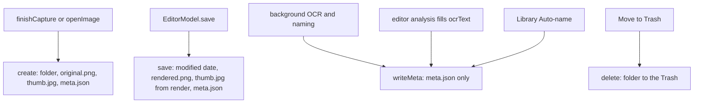
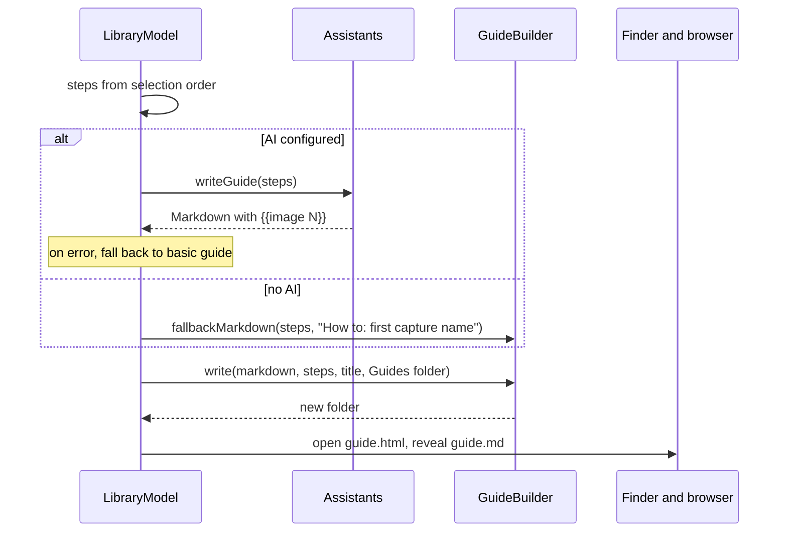

# Library and Handoff

> Category: Storage | Version: 1.0 | Date: November 2026 | Status: Active

For contributors touching anything Pinpoint writes to disk: the library's folder-per-capture layout and search, the guide folders GuideBuilder produces, handoff text and export folders, and the settings kept in UserDefaults.

**Related:**
- [`../editor/markup-and-rendering.md`](../editor/markup-and-rendering.md)
- [`../capture/capture-pipeline.md`](../capture/capture-pipeline.md)
- [`../ai/agent-and-providers.md`](../ai/agent-and-providers.md)
- [`../analysis/analysis-and-redaction.md`](../analysis/analysis-and-redaction.md)
- [`../glossary/glossary.md`](../glossary/glossary.md)
- [`../architecture/ADR-1-library-folder-per-capture.md`](../architecture/ADR-1-library-folder-per-capture.md)
- [`../architecture/ADR-2-stored-data-identifiers.md`](../architecture/ADR-2-stored-data-identifiers.md)

---

## Why plain folders

Pinpoint has no database. Each capture is a folder of ordinary files under `~/Pictures/Pinpoint/`, which makes the library easy to back up, search and open outside the app, and means one broken capture cannot damage the others ([ADR-1](../architecture/ADR-1-library-folder-per-capture.md)). The root path is a fixed identifier: moving it needs a launch-time migration ([ADR-2](../architecture/ADR-2-stored-data-identifiers.md)).

## On-disk layout

`LibraryStore` (`Sources/PinpointCore/Library.swift`) creates its root on init, defaulting to `LibraryStore.defaultRoot`, which is `Pictures/Pinpoint` in the user's home folder.

```
~/Pictures/Pinpoint/
  <UUID>/
    original.png     untouched screenshot, written once by create()
    rendered.png     image with markup and crop, written by save() when given a render
    thumb.jpg        long edge at most 480 px, JPEG quality 0.8
    meta.json        CaptureMeta, pretty-printed, sorted keys, ISO 8601 dates
  Guides/
    <title> <timestamp>/
      guide.md
      guide.html
      images/step-1.png ...
```

The folder name is the capture's UUID string. `loadAll()` lists the root, keeps only entries whose name parses as a UUID and whose `meta.json` decodes, and sorts newest first by `created`. The `Guides` folder is skipped because its name is not a UUID.

### CaptureMeta

`CaptureMeta` is everything known about a capture, encoded as `meta.json`. Its field names, and those of `Annotation` inside it, are a stored format: renaming them breaks existing libraries unless decoding stays backward compatible.

```swift
public struct CaptureMeta: Codable, Identifiable, Equatable, Sendable {
    public var id: UUID
    public var created: Date
    public var modified: Date
    public var name: String
    public var tags: [String]
    public var ocrText: String
    public var summary: String?
    public var sourceApp: String?
    public var width: Int
    public var height: Int
    public var annotations: [Annotation]
    public var crop: CGRect?
    public var aiNamed: Bool
}
```

### Write paths



| Method | Writes |
|---|---|
| `create(image:name:sourceApp:)` | New folder, `original.png`, thumbnail from the original, `meta.json` |
| `save(_:rendered:)` | Sets `modified`; if a render is passed, `rendered.png` and a thumbnail from the render; then `meta.json` |
| `writeMeta(_:)` | `meta.json` only, atomically, under a lock so background and main-thread writers do not interleave |
| `delete(_:)` | Moves the whole folder to the Trash (`trashItem`), so deletion is recoverable from Finder |

Image files go through `ImageFiles.write` (`Sources/PinpointCore/ImageIO.swift`), which encodes with ImageIO and writes atomically. `bestImage(_:)` returns `rendered.png` when it exists and the original otherwise; copying, dragging out of the library and guides use it.

### Search

`LibraryStore.search(_:query:)` splits the query on spaces and keeps captures where **every** word appears, case-insensitively, in a combined text of name, source app, summary, OCR text and tags (each tag included both as `#tag` and `tag`). OCR text comes from on-device analysis ([`../analysis/analysis-and-redaction.md`](../analysis/analysis-and-redaction.md)), so words inside screenshots are searchable.

`LibraryModel` (`Sources/Pinpoint/LibraryView.swift`) is the main-actor view model. It reloads all metas on a background task, filters with `search`, caches thumbnails in an `NSCache`, and reloads whenever `pinpointLibraryChanged` is posted. Its `selection` is an ordered list: the order captures are picked in becomes the step order of a guide. Move to Trash counts failed `delete` calls and reports "Moved N to Trash; M couldn't be moved: <reason>"; Auto-name skips a capture whose AI call or `writeMeta` fails and appends "Last error: …" to its final status.

---

## Guides

A guide is a step-by-step document made from several captures in order. `LibraryModel.makeGuide()` builds a `GuideStep` (best image, name, OCR text) for each selected capture and writes into `<library root>/Guides`.



`GuideBuilder.write` (`Sources/PinpointCore/Assistants.swift`) creates a folder named after the title (unsafe path characters replaced, first 60 characters) plus an ISO 8601 timestamp with colons replaced, writes every step image to `images/step-N.png`, replaces each `{{image N}}` with a Markdown image link, appends any image the model forgot to place, and writes `guide.md`. It then writes `guide.html` using a small built-in Markdown converter (`Markdown.toHTML`: headings, paragraphs, lists, images, links, bold, italics, inline code, with HTML escaping) and a simple embedded stylesheet. The guide title comes from the first `# ` heading in the Markdown, or the fallback title.

---

## Handoff

A handoff is one capture's notes and markup written as text for a coding agent or a teammate. `Handoff.markdown(meta:annotations:imagePath:ocr:)` (`Sources/PinpointCore/Handoff.swift`) produces:

```
## Screenshot: <name>
Image: <path>
Size: <w>×<h> px · App: <source app>

### Notes (numbers match the badges on the image)
1. Arrow pointing at “Save” (x 812, y 440)
   <note text, or (no note)>

Other markup: Outlined area around “Billing” (...); ...

Summary: <summary, if any>
```

Noted items are listed in badge-number order (the same numbering `Renderer.noteNumbers` draws). `describe` names what each item points at: its kind phrase, nearby OCR text (text inside the item's box, or the closest line within about 120 pixels of its point), its position, and the label for callouts and text. Items without notes appear on one "Other markup" line, except blur and redact items, which are left out. With no notes it says "(No notes added.)".

The editor offers two ways to send it (`Sources/Pinpoint/EditorModel.swift`, Handoff menu in `Sources/Pinpoint/MainWindow.swift`):

| Action | Result |
|---|---|
| Copy for AI agent | Saves first, then copies the Markdown with the absolute path of the capture's `rendered.png` |
| Export handoff folder | Saves, asks for a parent folder, creates `<name> handoff/` with `screenshot.png` (flattened), `screenshot-with-notes.png` (with the notes panel) and `notes.md` (the Markdown with a relative image path plus an embedded image link), then reveals `notes.md` in Finder |

The two image-copy items in the same menu copy pictures, not text; see [`../editor/markup-and-rendering.md`](../editor/markup-and-rendering.md).

---

## Settings in UserDefaults

`AppSettings` (`Sources/Pinpoint/AppSettings.swift`) is a main-actor singleton that writes each preference to `UserDefaults.standard` as it changes. API keys and ChatGPT tokens are not here; they are in the Keychain ([`../ai/agent-and-providers.md`](../ai/agent-and-providers.md)). The UserDefaults domain is the bundle id, which is a fixed identifier ([ADR-2](../architecture/ADR-2-stored-data-identifiers.md)).

| Key | Type | Default | Meaning |
|---|---|---|---|
| `provider` | String | `chatgpt` | Selected provider |
| `providers` | JSON data | One `ProviderSettings` per provider with its defaults | Model and base URL per provider |
| `chatgptAutoMigrated` | Bool | Set on first run | One-time switch of the ChatGPT model to `auto` |
| `autoNameWithAI` | Bool | true | AI name and tags after capture, when AI is configured |
| `copyAfterCapture` | Bool | true | Put the capture on the clipboard |
| `openEditorAfterCapture` | Bool | true | Open the capture in the editor |
| `autoRedactOnCapture` | Bool | false | Blur sensitive items when the editor opens |
| `askForContext` | Bool | true | Offer a note prompt after drawing an arrow or shape |
| `listenOnPrompt` | Bool | true | Start dictation when that prompt opens |
| `dictationSource` | String | `auto` | `auto`, `external` or `builtin` |
| `micUID` | String | Empty (system default) | Microphone for built-in dictation |
| `customRedactTerms` | String | Empty | Comma or newline separated words auto-redact always covers |

`Sources/PinpointCore/ChatGPTPlan.swift` adds `chatgptHostId` (stable sign-in host id) and `chatgptModelCache` with `chatgptModelCacheDate` (the plan's model list, cached for a day). The main window's frame is saved by AppKit under the autosave name `PinpointMain` (`Sources/Pinpoint/MainWindow.swift`).
