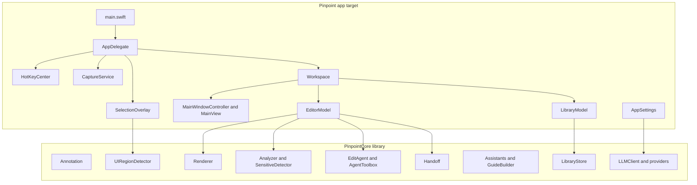
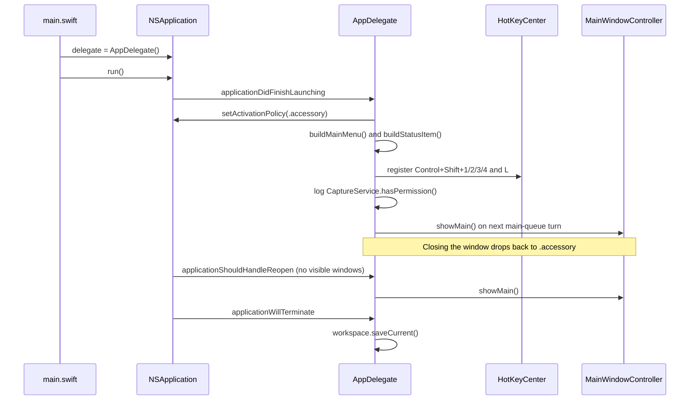

# System Overview

> Category: System | Version: 1.0 | Date: November 2026 | Status: Active

For contributors new to Pinpoint: how the two Swift targets divide the work, how the app starts and lives in the menu bar, and how the single main window, menus and global hotkeys connect to the rest of the system.

**Related:**
- [`../capture/capture-pipeline.md`](../capture/capture-pipeline.md)
- [`../editor/markup-and-rendering.md`](../editor/markup-and-rendering.md)
- [`../storage/library-and-handoff.md`](../storage/library-and-handoff.md)
- [`../ai/agent-and-providers.md`](../ai/agent-and-providers.md)
- [`../glossary/glossary.md`](../glossary/glossary.md)
- [`../architecture/ADR-2-stored-data-identifiers.md`](../architecture/ADR-2-stored-data-identifiers.md)

---

## Why the code is split in two

Pinpoint is a native macOS app built with Swift Package Manager for macOS 14 and later (`Package.swift`). The package declares three targets: `PinpointCore`, a library with no app UI, `Pinpoint`, the executable app that depends on it, and `PinpointCoreTests`, which tests only the core. Logic that can run without windows (markup model, rendering, on-device analysis, sensitive-text detection, AI clients, the agent, the library on disk, handoff text) lives in `PinpointCore` so it can be unit-tested. The app target holds everything that needs AppKit windows, ScreenCaptureKit, SwiftUI views or user settings, and it has no tests.

| Target | Key files | Role |
|---|---|---|
| `PinpointCore` | `Annotation.swift`, `Renderer.swift`, `Analyzer.swift`, `Sensitive.swift`, `UIRegionDetector.swift`, `LLM.swift`, `ChatGPTPlan.swift`, `CodexClient.swift`, `Agent.swift`, `Assistants.swift`, `Library.swift`, `Handoff.swift`, `ImageIO.swift`, `JSONValue.swift` | Pure logic and I/O, testable |
| `Pinpoint` | `main.swift`, `AppDelegate.swift`, `HotKeys.swift`, `CaptureService.swift`, `SelectionOverlay.swift`, `MainWindow.swift`, `EditorModel.swift`, `CanvasView.swift`, `EditorView.swift`, `LibraryView.swift`, `AppSettings.swift`, `SettingsView.swift`, dictation and note prompt files | Windows, capture, user input, settings |

---

## App lifecycle

`Sources/Pinpoint/main.swift` is six lines: it takes `NSApplication.shared`, creates an `AppDelegate` on the main actor, assigns it as the delegate and calls `app.run()`. There is no storyboard or SwiftUI `App` struct.

`AppDelegate` (`Sources/Pinpoint/AppDelegate.swift`) owns the long-lived objects: a `LibraryStore` created at its default root, a lazily created `Workspace`, the main window controller, the settings window and the array of selection overlays used during a capture. It also keeps a `capturing` flag so a second capture request is ignored while one is in progress.

On launch the app starts with the `.accessory` activation policy, which keeps it out of the Dock and the app switcher. It then builds the menus, registers hotkeys and logs the Screen Recording preflight result without prompting: the code comment notes the preflight can report false even when access works, so Pinpoint only asks after a capture actually fails (see [`../capture/capture-pipeline.md`](../capture/capture-pipeline.md)). Finally it opens the main window.

### Dock presence follows open windows

`activate()` switches the policy to `.regular` and activates the app whenever a real window is shown (main window, settings, an error alert). `updateActivationPolicy()` switches back to `.accessory` when neither the main window nor the settings window is visible. It runs when the main window closes (`MainWindowController.windowWillClose` calls `mainWindowClosed()`) and when the settings window posts `willCloseNotification`. The result: Pinpoint appears in the Dock only while a window is open and otherwise lives in the menu bar.

### Saving on the way out

`applicationWillTerminate` and `MainWindowController.windowWillClose` both call `Workspace.saveCurrent()`, so the open capture is written to the library when the window closes or the app quits.

---

## Main window and workspace

Pinpoint has one main window. `MainWindowController` (`Sources/Pinpoint/MainWindow.swift`) creates a 1280 by 820 titled, resizable window hosting the SwiftUI `MainView`, and persists its frame under the autosave name `PinpointMain`.

`Workspace` is the observable state behind that window. It holds the `LibraryStore`, a `LibraryModel` for the library grid, the current `EditorModel` (at most one capture is open at a time), the `mode` (`.editor` or `.library`) and the sidebar tab (Properties or Assistant). Key behaviour:

- `open(meta:image:)` does nothing but switch to editor mode if that capture is already open. Otherwise it saves the current capture and creates a fresh `EditorModel`.
- `open(id:)` loads the meta and original image from the store first.
- `saveCurrent()` calls `EditorModel.save()` (which re-renders) only when the editor is dirty or its markup or crop differ from the stored meta. Otherwise it just rewrites `meta.json`, which keeps name and tag edits. If that `writeMeta` fails, the error is shown in an alert.
- It observes the `pinpointLibraryChanged` notification and closes the editor if the open capture was deleted.

`MainView` stacks a `TopBar` over either the `LibraryView` or the editor. The top bar has a Capture menu button (primary action is area capture; the menu lists the four capture modes and Open Image), an Editor/Library segmented picker and, in editor mode, the tool strip and editor actions (undo, redo, reset crop, copy, Handoff menu, share, export, save). The editor body is a horizontal split of the canvas and a sidebar, with a tray of recent captures, search and zoom controls underneath. With no capture open, `EmptyEditor` shows a "Capture Now" button above the tray.

---

## Menu bar and main menu

Pinpoint has two menus, both built in code in `AppDelegate`.

The **status item** (`buildStatusItem`) uses the `camera.viewfinder` SF Symbol as a template image. Its menu offers Capture Area or Window, Capture Window, Capture Full Screen, Capture All Screens, Open Pinpoint, Open Image, Library, Settings and Quit.

The **main menu** (`buildMainMenu`) is the standard app menu bar visible while a Pinpoint window is active, so standard shortcuts work. It has Pinpoint (About, Settings, Quit), File (Capture Area or Window, Open Image, Library, Save to Library with Command+S, Export with Shift+Command+E, Close), Edit (Undo, Redo, Cut, Copy, Paste, Delete, Select All) and Window (Minimize). Save, Export, Undo and Redo are sent as untargeted selectors (`saveDocument:`, `exportDocument:`, `undo:`, `redo:`) through the responder chain: `CanvasView` handles undo, redo, copy and delete when it has focus, and `MainWindowController` implements save, export, undo and redo as a fallback.

---

## Global hotkeys

`HotKeyCenter` (`Sources/Pinpoint/HotKeys.swift`) registers system-wide shortcuts with Carbon's `RegisterEventHotKey`, which needs no Accessibility permission. It installs one keyboard event handler on first use, maps each hotkey id to a closure and dispatches the closure on the main queue. If registration fails (for example another app owns the shortcut), it logs that the hotkey is unavailable and carries on.

| Shortcut | Action |
|---|---|
| Control+Shift+1 | Capture area or window (`CaptureMode.area`) |
| Control+Shift+2 | Capture window (`CaptureMode.window`) |
| Control+Shift+3 | Capture the screen under the mouse (`CaptureMode.screen`) |
| Control+Shift+4 | Capture all screens (`CaptureMode.allScreens`) |
| Control+Shift+L | Open the library |

---

## Stored identifiers

The bundle id, the Keychain service and the library root name where users' data lives. Changing any of them needs a launch-time migration before `AppDelegate` creates the `LibraryStore`; see [ADR-2](../architecture/ADR-2-stored-data-identifiers.md). The capture flow is described next in [`../capture/capture-pipeline.md`](../capture/capture-pipeline.md).
